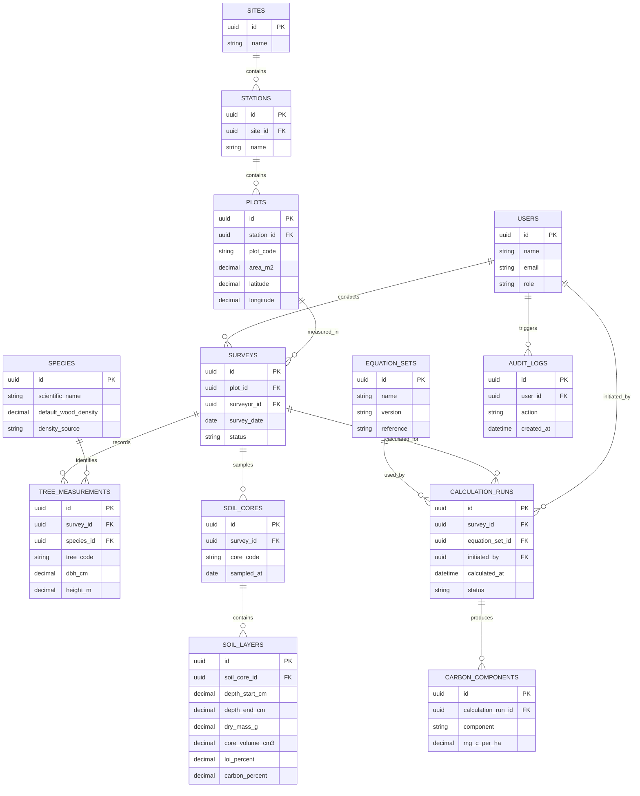
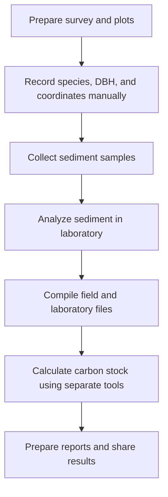
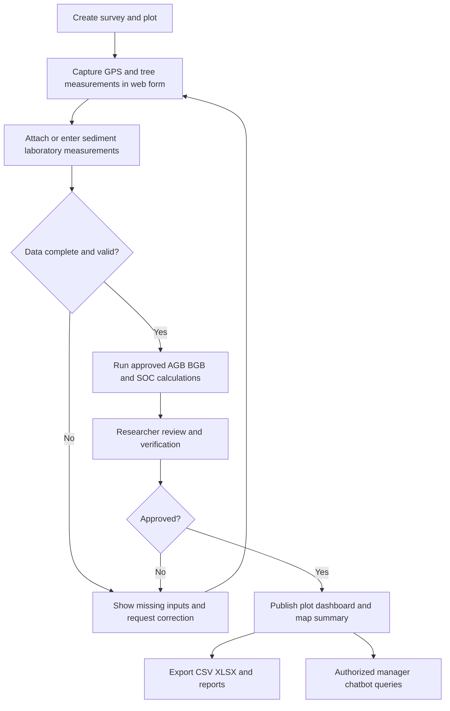
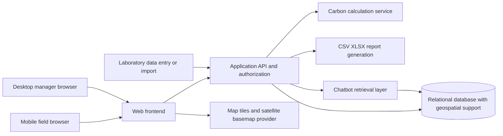

# Product Requirements Document (PRD)

## Web-Based Information System for Mangrove Carbon Stock Inventory

| Attribute | Detail |
|---|---|
| Document | Product Requirements Document |
| Version | 1.0 (initial draft) |
| Status | Draft for PIC validation |
| Product | Mangrove Carbon Stock Inventory |
| Platform | Responsive web application |
| Target context | Mangrove conservation and field inventory, with initial context of East Surabaya |
| Project cadence | Weekly progress review, every Monday at MCI Lab |
| Primary deliverable | Figma prototype, followed by a functional prototype as agreed with PIC |

> **Source boundaries:** Core scope is based on the supplied project description and meeting notes. Scientific field workflow is informed by the provided 2026 ITS community-service proposal *Pengukuran Biomassa dan Stok Karbon Mangrove di Atas dan di Bawah Permukaan Air (Pantai Surabaya Timur)*. Specific implementation choices, user roles, thresholds, and proposed enhancements below are **assumptions/recommendations**, not confirmed PIC requirements. They must be validated before implementation.

## 1. Executive Summary

The product is a web-based system for collecting mangrove field plot measurements, calculating biomass-derived carbon and soil organic carbon, visualizing results by plot on an interactive map, exporting datasets and reports, and providing a chatbot for conservation education and authorized data queries.

The project addresses a fragmented workflow in which field measurements (e.g., species, diameter at breast height or DBH, plot coordinates) are collected manually, laboratory soil measurements are processed separately, and data is later compiled for carbon-stock calculations and reporting.

The system should make **field recording easier**, reduce re-entry errors, support satellite imagery as a map baselayer, preserve calculation provenance, and connect georeferenced observations to a plot/species atlas-style interface.

## 2. Background and Problem

### 2.1 Problems

1. Field data collection is manual, including species, DBH, and geographic coordinates.
2. Plot observations, tree measurements, and soil laboratory results may be stored separately.
3. Calculating AGB, BGB, SOC, and carbon stock requires consistent scientific methods and units.
4. Managers need location-aware summaries and exportable reports, not just raw records.
5. Ecotourism visitors need accessible educational information about mangroves.
6. Existing mangrove map/atlas tools do not necessarily provide this project's complete inventory-to-carbon workflow.

### 2.2 Proposed Solution

A single responsive web application connecting:

**Field capture → Data validation → Biomass and soil carbon calculations → Geospatial visualization → Dashboard and export → Manager queries and public education.**

### 2.3 Product Goals

- Enable structured, plot-based mangrove inventory entry in the field.
- Associate observations with GPS coordinates and satellite basemap context.
- Calculate AGB, BGB, and SOC using PIC-approved methods and source data.
- Present carbon stock per plot, with standardized units (Mg C/ha).
- Support CSV/Excel export and summary report generation.
- Provide role-appropriate chatbot interactions.
- Produce a testable Figma prototype and demonstrate progress every Monday.

### 2.4 Non-Goals for Initial MVP

- Automatically measuring DBH accurately from a single ordinary phone photograph.
- Automatically deriving SOC from species/DBH or satellite imagery alone.
- Claiming satellite imagery itself validates field measurements.
- Carbon-credit certification, trading, or formal MRV accreditation.
- Nationwide monitoring or fully automated remote-sensing carbon estimates.
- Public chatbot access to confidential raw field data.

## 3. Existing Systems and Differentiation

### 3.1 Reference and Competitor Landscape

| Reference | Relevant capabilities | Opportunity for this product |
|---|---|---|
| [Atlas Sebaran Spesies — Kebun Raya Mangrove Kota Surabaya](https://realharyotpg-sketch.github.io/spesiesmangrovekrm/) | Interactive species-point map, zone/Vak filtering, species search, zone boundaries/labels, satellite/natural basemap switch; the page describes shapefile-based field data and Esri basemap | Add authenticated field capture, plot measurements, carbon calculations, and export linked to map features |
| [Global Mangrove Watch](https://www.globalmangrovewatch.org/) | Broad-scale mangrove mapping and monitoring | Focus on ground-truth field measurements and plot-level scientific calculation |
| [SI-PPEM](https://www.mangroves.app/) | Mangrove information and geospatial management in Indonesia | Focus on local inventory workflow, measurements, and calculations |
| Carbon estimation spreadsheets/scripts | Calculation-oriented workflows may exist | Connect calculations to structured records, coordinates, history, and reports |

**Important:** The references above are not evidence that this product is the first carbon-stock system. Feature-level competitor claims beyond the inspected reference site require further verification during research. Differentiation is a **proposed product positioning**, not a proven novelty claim.

### 3.2 Proposed Differentiators

1. **Field-first experience:** quick plot/tree forms, GPS capture, measurement validation, and draft saving.
2. **Map-linked records:** each observation belongs to a plot and appears on a satellite-backed interactive map.
3. **End-to-end carbon workflow:** AGB/BGB and sediment-based SOC in a unified per-plot carbon summary.
4. **Traceable science:** formula references, coefficients, inputs, units, and calculation versions retained.
5. **Operational exports:** raw records and calculated outputs in CSV/XLSX plus report summaries.
6. **Two chatbot experiences:** public education and permission-controlled manager data querying.

## 4. Stakeholders and Users

| Persona | Primary needs | Proposed permissions |
|---|---|---|
| Field Surveyor | Record plots, species, DBH, height, coordinates, and observations | Create/edit own drafts and submitted field records |
| Researcher / Carbon Analyst | Review measurements, enter lab results, verify formulas, inspect calculations | Review data, manage lab measurements, run calculations |
| Site Manager | See plots, carbon summaries, maps, trends, and exports | Read verified data, export, ask plot-data questions |
| Administrator | Maintain users, reference species, formula settings, and audit trail | Manage access and system configuration |
| Ecotourism Visitor | Learn about mangrove species and carbon conservation | Public map/educational chatbot only |

**To confirm:** Actual roles, data approval chain, and whether all these personas are needed for the semester prototype.

## 5. User Journeys

### 5.1 Field Surveyor

1. Sign in (if access is required).
2. Select existing site/station/plot or create a new plot.
3. Capture device GPS position or manually enter/edit coordinates.
4. Inspect location against map/satellite basemap.
5. Record species, DBH, optional height, wood density source, and notes for each tree.
6. Save as draft, review validation warnings, and submit.
7. Later correct a record with change history.

### 5.2 Carbon Analyst

1. Open a plot and review tree records.
2. Import or enter soil core layers and laboratory results (dry mass, core volume, layer thickness/depth, LOI-derived carbon fraction or directly measured %C).
3. Select or confirm the approved equation set.
4. Run calculations; inspect missing inputs and provenance.
5. Verify results and publish the plot carbon summary.

### 5.3 Site Manager

1. Open dashboard and map.
2. Filter by location, species, survey date, and status.
3. Select a plot to see AGB-carbon, BGB-carbon, SOC, and total carbon stock.
4. Export filtered raw and calculated data to CSV/XLSX; export a formatted report if included in scope.
5. Ask chatbot questions such as “Which verified plots have the highest carbon stock?”

### 5.4 Ecotourism Visitor

1. Open public education page or permitted public map.
2. Explore species and conservation facts.
3. Ask chatbot general questions about mangrove ecosystems and blue carbon.
4. Receive educational responses without access to restricted records.

## 6. Functional Requirements

Priorities: **P0 = essential MVP**, **P1 = next iteration**, **P2 = optional/stretch**.

| ID | Feature | Priority | Requirements | Acceptance criteria |
|---|---|---|---|---|
| FR-01 | Plot management | P0 | Create, view, edit plot with site/station, plot ID, area, date, coordinates | Unique plot ID; required fields validated; plot displayed in list |
| FR-02 | Tree inventory | P0 | Add multiple tree records per plot: species, DBH (cm), optional height (m), notes | Invalid/nonpositive DBH rejected; records remain linked to plot |
| FR-03 | GPS-assisted field capture | P0 | Use browser geolocation with permission; allow manual coordinates and correction | User can save coordinates manually if GPS unavailable; accuracy shown when available |
| FR-04 | Interactive map | P0 | Show plot markers with plot details; switch normal/satellite basemap | Selecting marker opens correct plot; basemap switch works |
| FR-05 | Carbon calculation: AGB/BGB | P0 | Apply PIC-approved allometric formulas, species/wood density rules, carbon fractions, plot-area conversion | Verified test dataset reproduces expected values within agreed tolerance |
| FR-06 | Soil measurements and SOC | P0 | Store soil layers, core volume, dry mass, depth/thickness, LOI or %C, and calculate SOC | SOC not reported as calculated if mandatory lab inputs are missing |
| FR-07 | Per-plot dashboard | P0 | Display plot details, species count, AGB carbon, BGB carbon, SOC, total Mg C/ha | Figures match stored calculation results; missing values labeled clearly |
| FR-08 | CSV/XLSX export | P0 | Export field inventory and calculation results with columns and units | Download opens in spreadsheet app; filters and units preserved |
| FR-09 | Data validation | P0 | Required-field, numeric-range, coordinate, duplicate and completeness checks | Errors identify field; no silent calculation with invalid data |
| FR-10 | Figma prototype | P0 | Clickable flows for field entry, plot map, dashboard, exports, chatbot | Team can demo all principal user journeys in Figma |
| FR-11 | Authentication and roles | P1 | Separate surveyor, analyst, manager, admin, public access | Restricted data not accessible to public or unauthorized roles |
| FR-12 | Manager chatbot | P1 | Answer questions about authorized plot data using structured retrieval | Answers reflect current verified dataset and show plot IDs/filters |
| FR-13 | Visitor education chatbot | P1 | Answer mangrove/ecotourism educational questions | No access to private plot records; unknown questions handled safely |
| FR-14 | PDF/report export | P1 | Formatted report with plot info, methodology, tables, figures, and dates | Generated report is readable and includes units and equation sources |
| FR-15 | Import CSV/XLSX | P1 | Bulk import historical tree and soil data | Preview mapping, validate rows, show import errors before commit |
| FR-16 | Review/approval workflow | P1 | Draft → submitted → verified/rejected → published | Only verified results marked publishable; changes logged |
| FR-17 | Field offline drafts | P1 | Save temporary records during intermittent connectivity and sync later | No loss of draft during supported offline flow; conflicts surfaced |
| FR-18 | Satellite data overlay | P2 | Overlay additional imagery-derived layers (e.g., land cover) if a source is available | Layer provenance, dates, and legend shown |
| FR-19 | Longitudinal monitoring | P2 | Compare repeat measurements across dates | Historical surveys remain separate; change calculations are reproducible |
| FR-20 | Photo attachments | P2 | Attach geotagged field photographs | Files linked to plot/tree and access controlled |

### 6.1 Field Entry Requirements

**Plot fields:** site, station, plot code, plot area (m²), latitude, longitude, survey date, surveyor, habitat/zone (optional), notes.

**Tree fields:** tree code, species (scientific name), DBH (cm), height (m, if needed by chosen equation), wood density (g/cm³, sourced from reference or approved manual input), condition, notes.

**Soil sample fields:** sample/core code, plot, sampling date, layer start/end depth (cm), dry mass (g), core volume (cm³), LOI (% organic matter) or carbon fraction (%C), laboratory source, analyst.

**Field assistance:** GPS capture, satellite basemap, species dropdown/autocomplete, duplicate warnings, save draft, visible units, data completeness indicator. Any camera-assisted species identification or DBH estimation is a separate research feature, not assumed reliable for MVP.

### 6.2 Map Requirements

- Plot coordinates as markers; clicking a marker opens plot details.
- Satellite and normal basemap selection.
- Search/filter by plot ID, species, station/zone, survey date.
- Display plot status and summarized carbon values where available.
- Preserve GPS coordinate reference convention (WGS84 latitude/longitude unless PIC specifies otherwise).
- Clearly distinguish **satellite imagery basemap** from **satellite-derived scientific measurements**. Using an Esri/other satellite basemap does not automatically import or estimate carbon data.
- Optional GeoJSON/shapefile layer import for site boundaries and zone/Vak polygons, subject to available source data and licensing.

### 6.3 Chatbot Requirements

**Visitor chatbot:** species information, mangrove ecology, carbon sequestration basics, conservation guidance; content from approved reference material. No private database access.

**Manager chatbot:** authorized, read-only questions about verified plots, species distributions, measurement dates, carbon values, and data completeness. Use constrained database queries/retrieval rather than allowing arbitrary SQL execution. Show source plot IDs and state when data is incomplete.

**MVP decision:** If delivery time is limited, prototype both chatbot interfaces in Figma; implement educational FAQ first and manager data querying in a later iteration.

## 7. Carbon Calculation Requirements

### 7.1 Scientific Constraints

- **AGB:** estimated with an appropriate species/condition-specific allometric equation using DBH, wood density, and/or height as required.
- **BGB:** estimated using an approved root biomass equation, often based on DBH and wood density or related biomass variables.
- **SOC:** **cannot be calculated solely from species and DBH**. Requires soil depth/layer thickness, bulk density, and organic carbon concentration (measured or estimated from validated LOI conversion).
- **Biomass ≠ carbon.** Convert AGB and BGB biomass into carbon with the appropriate validated carbon fractions before adding SOC.
- **Units:** report component carbon stocks and total in **Mg C/ha** (numerically equivalent to metric tonnes of carbon per hectare).
- **CO₂ equivalent (optional):** Mg CO₂e/ha = Mg C/ha × (44/12), if required in reports.

### 7.2 Calculation Pipeline

1. Validate tree and soil inputs.
2. Choose applicable allometric equation by species, condition, and method version.
3. Estimate biomass per tree; sum biomass within the plot.
4. Convert biomass to carbon using the agreed component-specific carbon fractions.
5. Normalize biomass carbon to plot area in hectares.
6. Calculate soil bulk density = oven-dry mass / core volume (with consistent units).
7. Convert LOI organic matter into %C only using an approved conversion, or use laboratory-measured %C.
8. Calculate SOC by soil layer using bulk density, %C, and layer thickness; sum layers and normalize to Mg C/ha.
9. Total carbon = aboveground carbon + belowground root carbon + soil organic carbon.
10. Save input snapshot, formula identifiers, constants, timestamp, and calculated outputs.

### 7.3 Formula Configuration and Verification

The supplied proposal cites Komiyama et al. (2005), Kauffman & Donato (2012), Malik et al. (2023), and IPCC guidance. Its method table mentions carbon fractions **0.47 for AGB** and **0.39 for BGB**, and CO₂ conversion factor **3.67**. These values should be treated as **proposal-specified defaults requiring PIC/scientific validation**, not universally correct constants for all methods or species.

**Required PIC inputs:** exact equation forms and coefficients, species lookup/wood density source, LOI-to-carbon conversion, sample validated calculations, missing-data handling, and acceptable numerical tolerance.

**Never silently substitute SOC = 0 or present an incomplete sum as total ecosystem carbon.** If SOC is unavailable, display “biomass carbon only” and indicate total ecosystem carbon is incomplete.

## 8. Data Model (Initial Proposal)



**Modeling note:** A plot can be surveyed multiple times; results should attach to a **survey** rather than overwriting plot history. Soil layers belong to a core sample. Species and equation references should be versioned or sourced.

## 9. Proposed Business Process

### 9.1 As-Is (To Validate with PIC)



This is an **inferred workflow** based on the notes and proposal, not a verified observation of the partner's actual process.

### 9.2 To-Be (Proposed)



## 10. UI/UX and Figma Prototype

### 10.1 Required Screens

| Screen | Essential elements |
|---|---|
| Landing / public information | Project overview, educational entry point, optional public map |
| Login | Authentication for internal roles (if confirmed) |
| Dashboard | Total plots, species, carbon components, chart, recent surveys |
| Plot list | Search, filters, statuses, create plot |
| Create/edit plot | Plot ID, site/station, area, GPS, satellite map pin |
| Tree measurements | Repeatable species/DBH/height entries, units, validation, draft save |
| Soil samples | Core/layer table, dry mass, volume, depth, LOI/%C |
| Carbon results | AGB/BGB/SOC breakdown, total Mg C/ha, methods and missing data |
| Interactive map | Plot markers, species/zone filters, satellite/natural basemap, plot drawer |
| Export center | CSV/XLSX options, selected fields, date/plot filters |
| Manager chatbot | Natural-language plot queries with cited plot IDs |
| Visitor chatbot | Mangrove education and conservation FAQs |

### 10.2 Prototype Priorities

**First Figma milestone:** Dashboard, plot list, create plot with GPS/satellite map, tree data entry, plot detail/carbon result, map, and export flow. Include chatbot screens if the agreed milestone covers the complete feature list.

**Interaction requirements:** clickable navigation, field validation states, empty/loading/error states, incomplete SOC state, and export confirmation. Show both desktop manager views and mobile field-entry views.

### 10.3 Visual Reference

The supplied reference [Atlas Sebaran Spesies](https://realharyotpg-sketch.github.io/spesiesmangrovekrm/) provides a useful model for a species map with search, zone filters, zone boundaries, and a **Satelit/Natural** basemap toggle. Use it as interaction inspiration; do not assume access to its data or reuse its code/assets without checking permissions.

## 11. Suggested Technical Architecture (Not Yet Approved)



**Suggested options, subject to team decision:** Next.js/React frontend, a relational database such as PostgreSQL with PostGIS, a backend API or secured server endpoints, Leaflet/MapLibre for maps, and a licensed imagery basemap. Choose stack only after reviewing team skills, hosting constraints, and data security.

**Integration considerations:** GPS via browser permission; satellite map tiles via provider; optional GeoJSON/shapefile imports; optional CSV/XLSX lab-data import; chatbot read-only access through an authorized retrieval API. No existing institutional API is confirmed.

## 12. Non-Functional Requirements

| Category | Requirement |
|---|---|
| Usability | Mobile-first field form, clear measurement units, minimal taps |
| Accuracy | Deterministic calculations, explicit precision and rounding, verified test fixtures |
| Data integrity | Input validation, database constraints, referential integrity, audit history |
| Security | Authenticated editing, role-based access, server-side authorization |
| Privacy | Public education cannot expose unpublished or sensitive coordinates/records |
| Performance | Typical plot list/map interaction should remain usable at expected dataset scale; quantify with PIC |
| Reliability | Error recovery, saved drafts, backups, failed-export feedback |
| Accessibility | Labeled inputs, keyboard navigation, readable contrast |
| Provenance | Preserve equation version, source references, survey timestamp, lab source |
| Interoperability | CSV/XLSX export with stable headers, units, UTF-8 CSV, and optional GeoJSON |
| Satellite maps | Attribution and usage comply with basemap provider licensing |

## 13. Export Specifications

### 13.1 Dataset Export

At minimum provide:

- **Plots:** plot ID, site, station, area, latitude, longitude.
- **Trees:** plot/survey ID, tree ID, species, DBH cm, height m, wood density and source.
- **Soil layers:** plot/survey ID, core ID, depth interval, dry mass, core volume, LOI/%C, bulk density.
- **Carbon results:** plot/survey ID, AGB carbon, BGB carbon, SOC, total Mg C/ha, equation version, calculation date, verification status.

For XLSX, prefer separate sheets for Plots, Trees, Soil, Results, and Metadata. For CSV, provide separate files or a documented flattened export. Dates and decimals should be unambiguous.

### 13.2 Report Export (P1)

Include site/plot metadata, survey date, method citations, input completeness, carbon breakdown, total Mg C/ha, map snapshot where licensed, and report generation date.

## 14. Backlog and Delivery Plan

This is a **suggested sequence**, not a commitment to fixed calendar dates.

| ID | Epic / Task | Priority | Deliverable | Dependencies |
|---|---|---|---|---|
| B-01 | Review proposal, PIC interview, confirm scope | P0 | Approved requirements and open-issues log | PIC access |
| B-02 | Research existing mangrove systems and novelty | P0 | Comparison matrix and positioning | Reference research |
| B-03 | Define personas, workflows, As-Is/To-Be | P0 | User flows and process diagrams | B-01 |
| B-04 | Create low-fidelity wireframes | P0 | Figma wireframes | B-01, B-03 |
| B-05 | Create interactive high-fidelity prototype | P0 | Clickable Figma prototype | B-04 |
| B-06 | Define field dataset and validation rules | P0 | Data dictionary | PIC/scientific input |
| B-07 | Confirm equations and validated example dataset | P0 | Calculation specification and test fixtures | PIC/scientific input |
| B-08 | Implement plots and tree records | P0 | Working CRUD flow | B-06 |
| B-09 | Implement GPS and satellite map | P0 | Interactive georeferenced plots | B-08, map provider |
| B-10 | Implement soil samples and carbon engine | P0 | Reproducible AGB/BGB/SOC calculations | B-07, B-08 |
| B-11 | Implement dashboard and plot detail | P0 | Carbon summaries and visualizations | B-10 |
| B-12 | Implement CSV/XLSX export | P0 | Downloadable datasets | B-08, B-10 |
| B-13 | Implement authentication and review status | P1 | Secure internal workflow | Roles confirmed |
| B-14 | Build educational chatbot | P1 | Public chatbot with approved content | Content sources |
| B-15 | Build manager data-query chatbot | P1 | Authorized plot Q&A | B-10, B-13 |
| B-16 | Implement import and offline drafts | P1 | Data migration / field resilience | B-08 |
| B-17 | User testing, scientific validation, bug fixes | P0 | UAT report and corrected prototype | Core flows |
| B-18 | Deploy and prepare demonstration | P0 | Demo URL and user guide | B-17 |

### 14.1 Suggested Initial Weekly Milestones

| Week | Monday MCI Lab progress target |
|---|---|
| 1 | Requirements summary, existing-system comparison, initial sitemap/user flows |
| 2 | Figma low-fidelity flows, field data dictionary, PIC questions |
| 3 | Clickable Figma prototype: plot entry, map, dashboard, export, chatbot |
| 4 | Prototype review feedback, updated PRD, approved calculation specification |
| 5+ | Implementation and validation in priority order, if required by the course/PIC |

If the current assignment is **Figma-only**, weeks 1–4 are the immediate commitment; implementation milestones are conditional.

### 14.2 Monday Progress Report Template

```markdown
# Weekly Progress — Mangrove Carbon Stock Inventory

**Week:**
**Date:**
**Team members:**

## Completed this week
-

## Demo / Figma links
-

## Decisions confirmed with PIC
-

## Blockers and risks
-

## Plan for next week
-

## Questions requiring PIC input
-
```

## 15. Success Metrics and Acceptance

Proposed metrics; set targets with PIC:

- Surveyor can create a plot and enter multiple tree measurements using a phone.
- Plot GPS point appears at the expected location on satellite/normal map.
- AGB/BGB/SOC calculations match PIC-approved reference examples.
- Incomplete soil data is flagged and not misrepresented as complete carbon stock.
- Manager can filter plots and export CSV/XLSX with correct units and records.
- Figma prototype supports an end-to-end demonstration without dead-end navigation.
- Public chatbot does not disclose restricted data; manager chatbot can explain where a numeric answer came from.
- Weekly Monday demo includes visible completed work, blockers, and next actions.

## 16. Risks and Mitigations

| Risk | Impact | Mitigation |
|---|---|---|
| No validated field/lab dataset | Cannot validate calculations | Request anonymized sample and expected outputs early |
| Formula selection differs by species | Incorrect carbon values | PIC-approved equation catalog, versioning, tests |
| SOC missing from field-only records | Incomplete ecosystem carbon | Explicit incomplete status and lab-data workflow |
| Poor field connectivity | Data loss | Draft saving; offline mode as P1 |
| Inaccurate device GPS | Wrong plot location | Show accuracy and allow manual correction |
| Basemap API cost/licensing | Deployment limitations | Verify provider terms and free-tier limits |
| Chatbot hallucinations | Misleading environmental information | Approved sources, constrained retrieval, uncertainty statements |
| Scope too broad | Missed prototype deadline | Deliver P0 Figma flows first, stage P1/P2 |
| Unclear novelty | Weak project justification | Compare end-to-end workflows, not just feature labels |

## 17. Open Questions for PIC

1. Is the immediate expected deliverable **Figma prototype only**, or also a working website? What is the deadline?
2. Who are the actual users and who validates/approves measurements?
3. Can we obtain a sample field dataset, soil laboratory results, plot coordinates, and an expected carbon calculation?
4. Which exact allometric equations, wood density sources, carbon fractions, and LOI-to-%C method are approved?
5. Is satellite imagery intended **only as a map baselayer**, or must the system process satellite-derived vegetation data?
6. Should the system use or import the existing Kebun Raya Mangrove atlas shapefiles/zone data? Is permission/access available?
7. Is offline field entry essential? Are there existing GIS, Excel, or institutional databases to integrate with?
8. Which chatbot features must work in the prototype, and which plot records may be public?
9. What is the required export format and report template?
10. Which criteria will be used to assess weekly MCI Lab progress and the final submission?

## 18. Source Notes

### User-supplied project brief and meeting notes

- Field plot input (species, DBH); automatic AGB/BGB/SOC to Mg C/ha.
- Per-plot dashboard and map; report export.
- Educational visitor chatbot and plot-data manager chatbot.
- Figma prototype, existing-system research and differentiation.
- Improved manual field capture including DBH and coordinates.
- Satellite-connected map experience.
- CSV/Excel export and weekly Monday MCI Lab updates.

### Provided 2026 ITS proposal

- Integrated measurement of aboveground biomass, belowground root biomass, and soil organic carbon in East Surabaya.
- Plot/station field inventory; DBH, species, height, wood density; sediment cores and laboratory LOI.
- Automatic calculation, database, dashboard, and reports.
- Scientific references: Komiyama et al. (2005), Kauffman & Donato (2012), Malik et al. (2023), and IPCC guidance.
- Proposal mockups: dashboard, field entry, AGB/BGB calculation, bulk density/SOC, carbon summary.

### Inspected reference website

- [Atlas Sebaran Spesies — Kebun Raya Mangrove Kota Surabaya](https://realharyotpg-sketch.github.io/spesiesmangrovekrm/): species map, zone filters, zone boundaries, and satellite/natural basemap options. Live data availability was not established from the inspected page.

---

**Document control:** Update priorities, formula rules, role permissions, and acceptance criteria after the first PIC review. Track decisions explicitly instead of treating draft assumptions as confirmed requirements.
