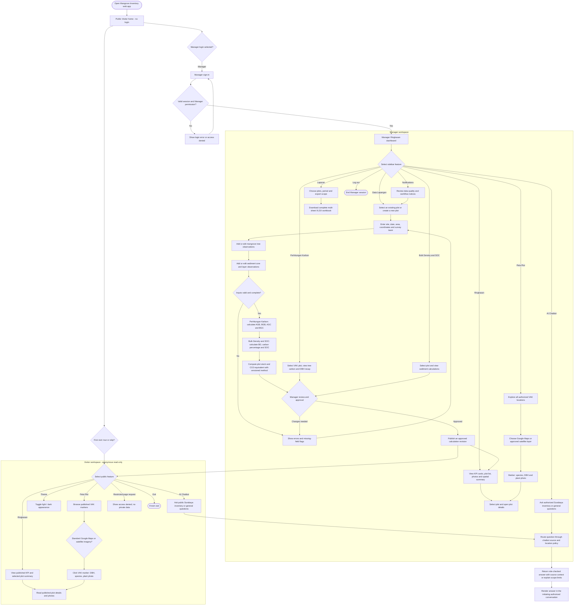
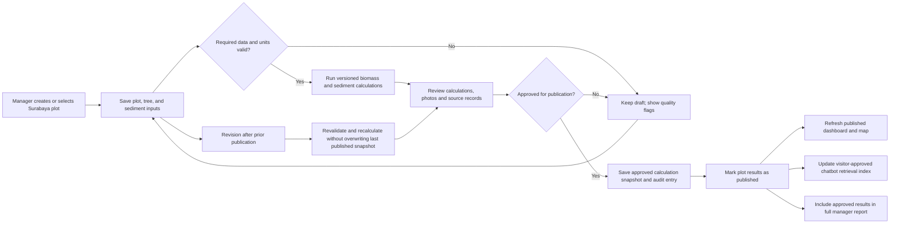
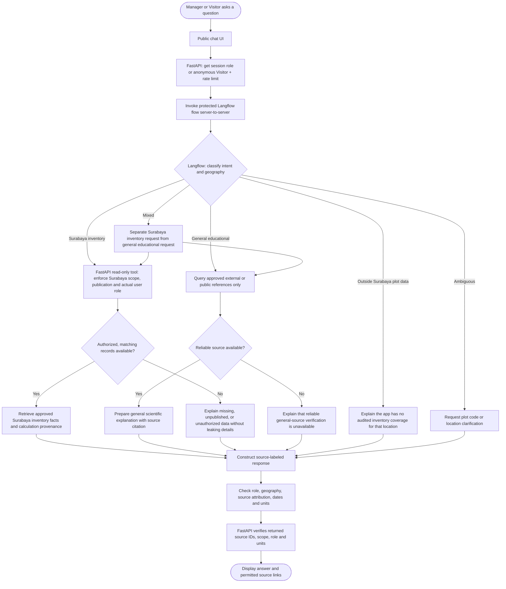
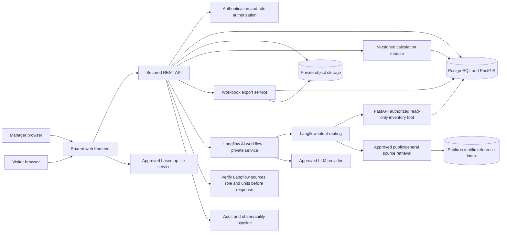

# Mangrove Carbon Stock Inventory Information System

**Product Requirements Document (PRD) — Version 1.4**

Pamurbaya / Wonorejo & Gunung Anyar, Surabaya

Web-based inventory, carbon calculation, sediment analysis, spatial mapping, reporting, and AI-supported exploration.

| **Document**               | **Value**                                                                                                      |
| -------------------------- | -------------------------------------------------------------------------------------------------------------- |
| Version / status           | 1.4 / Langflow selected for AI orchestration; implementation and scientific sign-off pending                   |
| Prepared                   | 05 November 2026                                                                                               |
| Primary users              | Manager / Field Researcher; Visitor                                                                            |
| Design basis               | 6 supplied UI mockups: Ringkasan, Data Lapangan, Perhitungan Karbon, Bulk Density & SOC, Peta Plot, AI Chatbot |
| Additional proposed screen | Laporan / Reports (not shown in the current mockups)                                                           |
| Language                   | Indonesian user interface; PRD in English                                                                      |

## Product in one sentence

A role-aware Surabaya mangrove inventory system that transforms audited tree and sediment measurements into transparent carbon-stock estimates, map-based insights, and exportable reports, supported by a geographically scoped AI chatbot.

## Working assumptions

- Numbers, coordinates, and researcher names visible in the mockups are sample UI data, not validated study results.

- The manager and visitor share a product and design system; access and navigation are role-specific.

- Internal inventory coverage is limited to approved mangrove study locations in Surabaya (the current study focuses on Pamurbaya, including Wonorejo and Gunung Anyar). The geographic boundary must be defined and approved by the project team.

- General educational answers from the AI chatbot use approved public/external knowledge sources, not the internal Surabaya inventory, unless the user explicitly asks for a Surabaya-specific inventory value.

- **Technology decision:** The chatbot workflow will use **Langflow** for intent classification, controlled retrieval orchestration, response composition, and reference handling. Langflow is **selected for implementation, not yet deployed or validated**. FastAPI remains the application's authorization and data-access gate; the versioned scientific calculator remains authoritative for all carbon values.

- Allometry coefficients, carbon fractions, and sediment conversion rules require approval from the project’s scientific supervisor before production use.

# 1. Product overview

## 1.1 Problem and opportunity

Mangrove stock inventories combine plot metadata, measurements per tree, sediment cores, calculations, photographs, and coordinates. When managed across separate files, data entry can be inconsistent, calculations difficult to reproduce, and reporting labor-intensive. The proposed product consolidates these workflows in one traceable interface and makes selected results understandable to public visitors.

## 1.2 Goals

| **ID** | **Product goal**                                          | **How success is assessed**                                                                                             |
| ------ | --------------------------------------------------------- | ----------------------------------------------------------------------------------------------------------------------- |
| G-01   | Centralize standardized field and sediment inventory data | A manager can create, revise, and review plots, trees, and sediment layers in one system.                               |
| G-02   | Compute consistent carbon stocks and CO₂ equivalents      | Every displayed result is reproducible from saved inputs and a versioned formula.                                       |
| G-03   | Make plots and distributions spatially discoverable       | A selected VAK plot opens interactive species/DBH/photo details on either approved map layer and matches the inventory. |
| G-04   | Share approved insights with visitors                     | Public users see only published information and cannot change data.                                                     |
| G-05   | Reduce report preparation effort                          | A manager can export a complete, multi-sheet workbook in one action.                                                    |
| G-06   | Improve access through conversational queries             | The AI answers grounded questions with plot IDs, units, and source context.                                             |
| G-07   | Enforce geographical and source boundaries for AI answers | Surabaya inventory questions use approved local records; general questions use public sources.                          |

## 1.3 Non-goals for MVP

- Remote-sensing classification, satellite-derived carbon estimation, or prediction of future carbon sequestration.

- Automated regulatory carbon-credit issuance or certification.

- Offline-first collection, multi-language translation, and direct external sensor integration.

- An AI assistant allowed to edit inventory records or generate ungrounded carbon values.

## 1.4 Stakeholders

Field researchers input data; a manager or analyst validates calculations and publishes selected findings; visitors consume public results; a scientific reviewer confirms methods, units, coefficients, and assumptions; a system administrator manages permissions and availability (administrative functions may be combined with Manager for MVP).

# 2. Users, permissions, and navigation

## 2.1 Role definitions

**Authentication rule (SE revision).** The website opens in **Public / Visitor mode without login**. Public visitors can open published pages, interactive plot maps, and the public AI chatbot immediately. Selecting a manager-only action (such as adding a tree or sediment sample, editing data, approving results, or exporting a complete internal report) redirects to the **Manager Login** page. There is no public registration requirement for the chatbot. A visual “Manager / Visitor” chat tab must never grant manager privileges.

| **Role**                 | **Primary needs**                                                                         | **Permission principle**                                                                                |
| ------------------------ | ----------------------------------------------------------------------------------------- | ------------------------------------------------------------------------------------------------------- |
| Manager                  | Maintain plots, trees, core samples, calculations, photos, exports, and published status. | Create, read, update, and delete own / authorized records; export full data; access private AI context. |
| Visitor                  | Understand mangroves, browse maps and published carbon stocks, ask public questions.      | Read only published content; no raw private data, editing, or manager exports.                          |
| Administrator (optional) | Manage access and audit/operations settings.                                              | Privileged setup; not a substitute for scientific review.                                               |

## 2.2 Information architecture and access

| **Navigation / capability** | **Manager**                         | **Visitor**                                                        |
| --------------------------- | ----------------------------------- | ------------------------------------------------------------------ |
| Ringkasan / Dashboard       | Full operational dashboard          | Published summary only                                             |
| Data Lapangan               | View + enter / edit / delete        | Hidden                                                             |
| Perhitungan Karbon          | Full method + record-level outputs  | Selected aggregate explanation only                                |
| Bulk Density & SOC          | Full method + sample data           | Hidden                                                             |
| Peta Plot                   | All authorized plots + details      | Only published plot points + summary                               |
| Laporan / Reports (new)     | Full Excel export / audit metadata  | No full export; optional public summary                            |
| AI Chatbot                  | Manager mode / authorized inventory | **Available anonymously**; published inventory + general knowledge |
| Notifications               | Validation and workflow notices     | Optional published notices                                         |

**UX rule.** Use one responsive application shell with common visual components and a role-filtered sidebar. Do not create two unrelated applications unless infrastructure constraints require them. Public pages are the default entry point. Offer a visible **Manager Login** action, a first-visit guided tour (once the site is ready), and a persistent **Light / Dark Mode** toggle for both user experiences.

**Plot naming rule.** All plot codes follow the `VAK-<number>` convention (e.g., `VAK-04`) consistently across maps, dashboards, reports, data imports, API responses, and chatbot citations. **VAK is an identifier prefix, not a physical measurement unit**; scientific units remain cm, kg, g/cm³, Mg C/ha, etc.

# 3. Key user journeys

1.  Manager signs in, opens Data Lapangan, selects an existing plot or creates a new plot, and records site, survey date, dimensions, coordinates, and field team.

2.  Manager adds tree observations (species, DBH, wood density, optional height, documentation) and sediment layer/core measurements; invalid or incomplete fields are highlighted.

3.  The system calculates AGB, BGB, AGC, BGC, bulk density, %C, and SOC using an explicit method version; managers review completeness and approve publication.

4.  Manager inspects plot-level distribution on Ringkasan and geographic placement in Peta Plot; the values and statuses remain consistent across screens.

5.  Manager opens Laporan and downloads a workbook containing summary, plots, trees, sediment, calculations, and data quality metadata.

6.  An anonymous visitor opens public Ringkasan or Peta Plot, toggles between standard Google Maps and approved satellite imagery, clicks a VAK marker to inspect species, DBH and plant photo, or asks the AI chatbot without signing in; general educational questions use public/external references.

7.  On first visit after release, a user may take or skip a short feature tour; both public and manager experiences support accessible Light and Dark themes.

8.  Manager produces a traceable DBH recap by VAK plot and species using the project team's authorized Drive source data; the system calculates AGB/BGB and applies approved biomass-to-carbon coefficients for AGC/BGC.

## 3.1 Complete application flow (Mermaid)

This diagram covers entry, access control, every main UI page, plot selection, data collection, computation, publication, map exploration, reporting, and chatbot entry. Page navigation remains available while a user is in an authorized workspace.



## 3.2 Inventory data and publication lifecycle (Mermaid)

The system must not interpret a saved draft or a recalculation as automatically approved for public release.



# 4. Functional requirements by screen

## 4.1 Authentication, shell, and selection

| **ID / priority** | **Requirement**                                                        | **Acceptance behavior**                                                                      |
| ----------------- | ---------------------------------------------------------------------- | -------------------------------------------------------------------------------------------- |
| FR-01 / P0        | Role-aware sign-in / session and protected routes.                     | Visitor is blocked from manager-only pages and API writes; controls are not merely hidden.   |
| FR-02 / P0        | Persistent sidebar, active states, notification area, role identity.   | Navigation and role labels are consistent; current page is clear.                            |
| FR-03 / P0        | Shared selected plot context.                                          | Changing selected plot updates related records / metrics on calculations and sediment pages. |
| FR-04 / P1        | Manager notifications for data quality, review, and export completion. | Notifications identify the relevant plot and actionable issue.                               |

## 4.2 Ringkasan (dashboard)

| **ID / priority** | **Requirement**                                                                                        | **Acceptance behavior**                                                                                         |
| ----------------- | ------------------------------------------------------------------------------------------------------ | --------------------------------------------------------------------------------------------------------------- |
| FR-05 / P0        | Show average carbon stock (Mg C/ha), CO₂-equivalent (Mg CO₂e/ha), plot coverage, and dominant species. | Numbers are derived from eligible records, indicate units and valid-plot denominator, and display empty states. |
| FR-06 / P0        | Show selected plot identity, coordinates, total stock, AGB/BGB/SOC distribution, and field photos.     | Component percentages total approximately 100% after rounding; missing photos use placeholders.                 |
| FR-07 / P0        | Show selectable inventory plot list and spatial overview.                                              | Selecting a plot updates its detail card; “Peta Penuh” opens the corresponding map position.                    |
| FR-08 / P1        | Download summary via “Unduh Rekap”.                                                                    | A manager receives a dated, filtered summary; visitor behavior follows public-export policy.                    |

## 4.3 Data Lapangan – plot, trees, and sediment

| **ID / priority** | **Requirement**                                                                                           | **Acceptance behavior**                                                                                   |
| ----------------- | --------------------------------------------------------------------------------------------------------- | --------------------------------------------------------------------------------------------------------- |
| FR-09 / P0        | Create or edit plot metadata: unique code, name/zone, survey time, dimensions, GPS coordinates, surveyor. | Required fields validated, unique plot code enforced, status visible.                                     |
| FR-10 / P0        | Create, edit, delete, filter, and export tree records.                                                    | Species, DBH, wood density, optional height and documentation persist against the selected plot.          |
| FR-11 / P0        | Create, edit, delete, filter, and export sediment core/layer records.                                     | Depth interval, dry mass, core volume, LOI and supporting photo save with correct layer/core association. |
| FR-12 / P0        | Provide record provenance and safe deletion.                                                              | Destructive actions require confirmation; edits produce an audit entry and calculations refresh.          |

## 4.4 Perhitungan Karbon

| **ID / priority** | **Requirement**                                                                                   | **Acceptance behavior**                                                                              |
| ----------------- | ------------------------------------------------------------------------------------------------- | ---------------------------------------------------------------------------------------------------- |
| FR-13 / P0        | Display approved AGB/BGB equations, assumptions, method references, and version.                  | Equation labels, input units, and biomass versus carbon outputs are distinct.                        |
| FR-14 / P0        | Calculate tree-level AGB, BGB, AGC, BGC and plot-normalized Mg C/ha.                              | Output recalculates deterministically from saved DBH, species / wood density, area and coefficients. |
| FR-15 / P0        | Show stand carbon, root carbon, biomass carbon and ecosystem stock; provide tree and plot tables. | Ecosystem stock includes SOC exactly once and excludes incomplete records from official totals.      |
| FR-16 / P1        | Filter and export calculation detail.                                                             | Export preserves displayed filters and includes formula version.                                     |

## 4.5 Bulk Density & SOC

| **ID / priority** | **Requirement**                                                      | **Acceptance behavior**                                                                         |
| ----------------- | -------------------------------------------------------------------- | ----------------------------------------------------------------------------------------------- |
| FR-17 / P0        | Show bulk-density, %C and SOC equations and sediment sample results. | Displays layer depth ranges, dry mass, volume (cm³), LOI (%), BD (g/cm³), %C and SOC (Mg C/ha). |
| FR-18 / P0        | Aggregate layer SOC to a per-plot profile total.                     | Non-overlapping validated layers are added; missing layers flag incomplete profile.             |
| FR-19 / P1        | Filter and export sediment calculations.                             | Users can trace SOC values to underlying samples and method version.                            |

## 4.6 Peta Plot (map)

| **ID / priority** | **Requirement**                                                                                            | **Acceptance behavior**                                                                       |
| ----------------- | ---------------------------------------------------------------------------------------------------------- | --------------------------------------------------------------------------------------------- |
| FR-20 / P0        | Render georeferenced VAK points on standard and satellite basemaps with zoom/pan.                          | Marker locations persist across map-layer changes; coordinates and permissions are validated. |
| FR-21 / P0        | Click a plot/tree marker for VAK, species, DBH (cm), plant photograph, status and eligible carbon summary. | Popovers match the linked field records; public content is published-only.                    |
| FR-22 / P1        | Filter markers by zone, status and carbon range; navigate to plot details.                                 | The marker subset and legend update together.                                                 |

## 4.7 AI Chatbot

Requirement IDs remain stable across PRD versions; FR-29 through FR-32 are newly added and are grouped here with their related chatbot features.

| **ID / priority** | **Requirement**                                                                                | **Acceptance behavior**                                                                                             |
| ----------------- | ---------------------------------------------------------------------------------------------- | ------------------------------------------------------------------------------------------------------------------- |
| FR-23 / P0        | Offer Manager / Visitor experiences with separate authorization, not merely a cosmetic toggle. | A visitor cannot retrieve unpublished plots, personal details or raw manager data.                                  |
| FR-24 / P0        | Answer inventory and educational questions using their correct, separate source classes.       | Inventory answers use approved Surabaya records; general answers use authoritative public/external sources.         |
| FR-25 / P1        | Support conversation history, suggestions and clarification for ambiguous plot IDs.            | Follow-up questions retain relevant context; manager history is not publicly exposed.                               |
| FR-29 / P0        | Enforce a Surabaya-only boundary for internal inventory retrieval.                             | Queries for stock, species, measurements, or plots retrieve only authorized records inside approved Surabaya scope. |
| FR-30 / P0        | Route general educational questions to public/external reference sources.                      | General answers do not use private or internal Surabaya records as evidence; source attribution is provided.        |
| FR-31 / P0        | Handle other-region and mixed-location queries without cross-region substitution.              | Outside-Surabaya plot questions state the coverage limit; mixed requests separate grounded local and general parts. |
| FR-32 / P0        | Enforce server-side source, geography and user-role checks for every chatbot retrieval.        | The model cannot bypass policy via prompts, page toggle, cached context, or a follow-up question.                   |

### Chatbot orchestration requirement added in PRD v1.4

| **ID / priority** | **Requirement**                                                                                                             | **Acceptance behavior**                                                                                                                                                                       |
| ----------------- | --------------------------------------------------------------------------------------------------------------------------- | --------------------------------------------------------------------------------------------------------------------------------------------------------------------------------------------- |
| **FR-41 / P0**    | Use **Langflow** as the chatbot workflow orchestrator for anonymous Visitors and authenticated Managers.                    | Both roles can ask an allowed question through the web UI and FastAPI; each request executes a versioned Langflow flow and returns a grounded response without exposing Langflow credentials. |
| **FR-42 / P0**    | Route Surabaya VAK inventory, general education, outside-scope, mixed, and ambiguous questions to the correct guarded path. | Local data comes only from authorized FastAPI read tools; public/general data comes from an approved reference source; unsupported/out-of-scope requests do not fabricate measurements.       |

## 4.8 Laporan / Reports (proposed screen)

| **ID / priority** | **Requirement**                                                                | **Acceptance behavior**                                                                           |
| ----------------- | ------------------------------------------------------------------------------ | ------------------------------------------------------------------------------------------------- |
| FR-26 / P0        | Show export scope, available plots, reporting date, completeness, and filters. | Manager can choose all eligible plots and check what will be included.                            |
| FR-27 / P0        | One-click downloadable Excel workbook for complete inventory.                  | Workbook includes linked sheets, metadata, units, calculation version, and audit / quality flags. |
| FR-28 / P1        | Optional PDF executive summary and scheduled exports.                          | Deferred until XLSX flow is accurate and approved.                                                |

## 4.9 SE Progress Review — additional requirements (05 November 2026)

| ID / priority  | New requirement                                                                                                                                                                                | Acceptance behavior                                                                                                                                                                   |
| -------------- | ---------------------------------------------------------------------------------------------------------------------------------------------------------------------------------------------- | ------------------------------------------------------------------------------------------------------------------------------------------------------------------------------------- |
| **FR-33 / P0** | **Anonymous public access:** Visitors can browse approved pages and use the AI chatbot **without registration or login**.                                                                      | Fresh incognito browser can send a valid chat question; only published VAK data and approved general references are accessible.                                                       |
| **FR-34 / P0** | **Manager authentication:** Login is required to create/update field data, modify calculations, approve publication, or access complete exports.                                               | Direct deep links and API calls to data entry or private endpoints are denied until authenticated as Manager.                                                                         |
| **FR-35 / P1** | **Feature tour:** Once the website is delivered, provide a concise interactive walkthrough for the dashboard, plot map, chatbot, and manager tools as appropriate.                             | Tour may be started, skipped, restarted; role-appropriate steps do not expose private features to public users.                                                                       |
| **FR-36 / P0** | **Canonical VAK plot codes:** Use `VAK-01`, `VAK-02`, etc. consistently across all modules.                                                                                                    | UI, API, map popup, Excel, chatbot and imported data show the same unique VAK code.                                                                                                   |
| **FR-37 / P0** | **Two map views:** Toggle between **standard Google Maps** and **approved satellite imagery** (e.g. Sentinel-2 or a NASA Worldview/GIBS service where compatible and licensed).                | Switching layers preserves viewport, VAK markers, selected plot and visibility policy; imagery source, date and attribution are displayed.                                            |
| **FR-38 / P0** | **Interactive plant details:** Click a map plot/tree marker to view DBH (cm), species scientific name and plant image; show related VAK code and public/manager visibility state.              | The popup uses stored record IDs and handles missing DBH/photos explicitly; public view never reveals unpublished images or trees.                                                    |
| **FR-39 / P0** | **DBH recap from project Drive source:** Manager can use the verified team Drive DBH dataset to generate a per-tree and per-VAK recap of DBH, AGB, BGB, AGC and BGC with applied coefficients. | Recap includes source file/version, row identifiers, wood-density source, coefficient/method version, computed totals and exception flags; results reconcile with Perhitungan Karbon. |
| **FR-40 / P1** | **Light/Dark Mode:** Both roles can switch interface appearance.                                                                                                                               | Choice persists for returning users when possible; charts, overlays, popups, chatbot and tables remain readable in both modes.                                                        |

### User-facing design implications

- **Landing page:** public dashboard or accessible chatbot, with “Manager Login” in the header. Manager-only sidebar items are hidden from Visitors, and the backend rejects unauthorized requests.
- **Website tour:** small `Mulai Tur` / `Lewati` controls on initial public visit, plus a persistent `Panduan Fitur` entry for restarting it.
- **Map page:** two-option basemap selector (`Google Maps` / `Satellite / Sentinel-2`), clickable VAK and tree points, and an information popup with `VAK`, species, `DBH (cm)`, photo, and last survey date.
- **Carbon page / Laporan:** add a `Rekap DBH` table or export scope so the manager can trace each tree's DBH through the approved AGB/BGB formula and carbon-conversion factors.
- **Global header:** `Light / Dark` theme toggle available without login.

**External interaction reference (provided by stakeholder):** https://realharyotpg-sketch.github.io/spesiesmangrovekrm/ . It is a design-reference URL for map interaction, **not** a validated data source or proof that its implementation should be copied.

**Data-source clarification:** The team Drive file containing DBH measurements must be linked by exact file ID/path and reviewed by the Manager before import. A Drive file's existence, structure or numerical contents must not be assumed from its title alone.

# 5. Core data model

Suggested relational entities. IDs are immutable internal identifiers; plot codes are unique human-readable keys.

| **Entity**         | **Required fields (indicative)**                                                | **Relations / notes**                                                                             |
| ------------------ | ------------------------------------------------------------------------------- | ------------------------------------------------------------------------------------------------- |
| User               | user_id, role, display_name, status                                             | Author / reviewer of records; identity must not appear in public exports by default.              |
| Site / Zone        | zone_id, name, approved_surabaya_scope, geography / region                      | One zone has many plots.                                                                          |
| Plot               | plot_id, VAK code, zone_id, area_m², latitude, longitude, survey_date, status   | `VAK-<number>` naming; one plot has many trees, cores, photographs, results.                      |
| Tree               | tree_id, plot_id, species_id, DBH_cm, density_g_cm³, recorded_at, source_row_id | Optional height_m, photo_id, notes, QA status; reference validated Drive import where applicable. |
| Species            | species_id, scientific_name, display_name, default_density                      | Density source and version stored; overrides reviewed.                                            |
| SedimentCore       | core_id, plot_id, position, sampled_at                                          | Contains ordered, non-overlapping intervals.                                                      |
| SedimentLayer      | layer_id, core_id, top_cm, bottom_cm, dry_mass_g, volume_cm³, LOI_percent       | Calculated BD, %C, SOC and QC status.                                                             |
| MethodVersion      | method_id, AGB_formula, BGB_formula, fractions, SOC_rule                        | Reference, approval status, effective date, rounding rule.                                        |
| CalculationRun     | run_id, plot_id, method_id, input_revision, generated_at                        | Snapshots results and traceability, not manual overwrite.                                         |
| Attachment / Audit | file_id, linked_record; event_id, actor, action, changed_fields, timestamp      | Photo provenance; record change tracking.                                                         |
| Publication        | plot_id, state, reviewed_by, published_at                                       | Gate for visitor / chatbot access.                                                                |

# 6. Calculation and business rules

The following are the equations currently visible in the mockups. They define the proposed application logic but must be approved against the project’s research method before release.

| **Metric**                  | **Expression / rule**                                  | **Displayed unit**    |
| --------------------------- | ------------------------------------------------------ | --------------------- |
| AGB (tree)                  | 0.251 × ρ × DBH^2.46                                   | kg dry biomass / tree |
| BGB (tree)                  | 0.199 × ρ^0.899 × DBH^2.22                             | kg dry biomass / tree |
| AGC / BGC                   | AGC = AGB × 0.47; BGC = BGB × 0.39                     | kg C / tree           |
| Plot stand / root stock     | Sum(tree carbon kg) × 10,000 ÷ (1,000 × plot_area_m²)  | Mg C/ha               |
| Bulk density, BD            | dry_mass_g ÷ core_volume_cm³                           | g/cm³                 |
| Organic carbon %C           | LOI_percent ÷ 1.724 (if using Van Bemmelen conversion) | %                     |
| Layer SOC                   | BD × layer_thickness_cm × (%C ÷ 100) × 100             | Mg C/ha               |
| Total plot ecosystem carbon | AGC_stock + BGC_stock + SUM(layer_SOC)                 | Mg C/ha               |
| CO₂ equivalent of stock     | Total_carbon_stock × (44 ÷ 12)                         | Mg CO₂e/ha            |
| Plot coverage               | valid / target × 100; expose denominator               | %                     |

**Important terminology.** Carbon stock expressed as CO₂e is not the same as annual CO₂ absorption or sequestration rate. The dashboard label “Serapan CO₂e” should be reconsidered unless the project actually measures change over time.

## 6.1 Validation and aggregation

- DBH, plot area, dry mass, core volume, and layer thickness must be positive; wood density and LOI must fall within scientifically approved allowed ranges.

- Core intervals must be expressed as top/bottom depth in centimeters and must not overlap within a single profile.

- Unset species, missing density, or incomplete sediment measurements must be flagged; no artificial zero values enter official aggregate totals.

- When plot areas vary, calculate each Mg C/ha value using its actual sampled area. Define whether multi-plot summary is an arithmetic or area-weighted average and label it.

- Use full precision internally; round only for display or export. Preserve original input, method version and recalculation time.

- Allow draft and verified results; only reviewed / published results feed the visitor dashboard and visitor chatbot.

# 7. Proposed Laporan screen and export schema

## 7.1 Page layout

Header: “Laporan Inventarisasi Mangrove” with a primary “Unduh Semua Laporan (.xlsx)” action. A summary row presents plots included, tree records, core/layer records, latest survey date, and data completeness. A filter row provides zone, date period, plot status and optional plot IDs. Below it, show a preview table with plot code, location, trees, AGC, BGC, SOC, ecosystem total, CO₂e, survey date and QA status.

## 7.2 Excel workbook sheets

| **Worksheet**     | **Grain / purpose**                            | **Essential columns**                                                                                                 |
| ----------------- | ---------------------------------------------- | --------------------------------------------------------------------------------------------------------------------- |
| 00_Petunjuk       | Export documentation                           | Generated time, filters, timezone, units, method version, definitions, disclaimer                                     |
| 01_Ringkasan      | One record per selected plot / overall summary | Plot code, zone, area, trees, AGC/BGC/SOC, total, CO₂e, completeness                                                  |
| 02_Data_Plot      | One record per plot                            | Plot ID, code, location, coordinates, area, date, surveyor, publication status                                        |
| 03_Data_Pohon     | One record per tree                            | Tree ID, plot ID, species, DBH, height, ρ, photo / QA reference                                                       |
| 04_Data_Sedimen   | One record per sediment layer                  | Core/layer IDs, depth interval, mass, volume, LOI, BD, %C, SOC                                                        |
| 05_Perhitungan    | One record per tree + plot totals as specified | Inputs, AGB, BGB, AGC, BGC, normalized stock, method_version                                                          |
| 06_Validasi_Audit | Data-quality exceptions / export provenance    | Entity ID, missing field, issue, review status, timestamp / version                                                   |
| **07_Rekap_DBH**  | One record per tree plus per-VAK aggregates    | VAK code, source file/row, species, DBH (cm), ρ, AGB/BGB (kg), AGC/BGC (kg C), coefficients, method version, QA flags |

## 7.3 Export behavior

- Primary download is a real .xlsx file with numeric cells stored as numbers, filters/frozen headings, a human-readable README, and consistent unit labels.

- “All reports” includes every sheet in one workbook; specific page Export buttons can provide filtered subsets without changing source data.

- Default export includes validated records with flags for drafts and incomplete samples when manager chooses “include drafts.”

- Each workbook records the generation timestamp, applicable filters, data revision and calculation method version.

- Visitor-level exports, if enabled, must contain public summary data only and exclude internal audit or personal information.

# 8. AI chatbot requirements

## 8.1 Example supported intents

| **Audience** | **Example question**                                    | **Expected behavior**                                                                  |
| ------------ | ------------------------------------------------------- | -------------------------------------------------------------------------------------- |
| Visitor      | What is mangrove carbon stock?                          | Explain AGB, BGB, SOC and units in accessible Indonesian.                              |
| Visitor      | How much carbon is stored in the published VAK-04 plot? | Answer from latest published calculation, state its timestamp and component breakdown. |
| Manager      | Which plots are missing sediment layers?                | Return authorized incomplete plots and the missing fields.                             |
| Manager      | Compare carbon stock of VAK-01 and VAK-04.              | Use the same approved method and scope; show values, units and method/date.            |
| Either       | What is total stock for a non-existent plot?            | Say no verified data is available; ask for a valid plot identifier.                    |

## 8.2 AI safety and accuracy

- Ground numeric answers in an approved query layer or authoritative calculation records; never let the LLM invent carbon calculations or sources.

- Respect user role in retrieval. The on-screen Manager / Visitor tab cannot elevate authorization.

- Provide plot code, record date, value, unit, data/publication status and a link to the source screen where possible.

- For missing or conflicting data, respond with uncertainty and identify the issue; do not substitute other plots silently.

- Do not treat user-entered field notes or chatbot prompts as instructions to disclose private records or override scientific method.

- Log model / prompt version and source record references for operational review without exposing visitor messages publicly.

## 8.3 Chatbot geographic boundaries and source-of-truth policy

**Policy statement (English).** The AI chatbot must operate within the geographical boundaries of Surabaya for _application-specific mangrove inventory data_. When a user asks a _general educational or scientific question_, the chatbot must respond using approved external/public reference information instead of internal Surabaya inventory records. The chatbot must never imply that a Surabaya plot measurement describes another city or region.

**Inventory coverage:** Surabaya, Indonesia, with the current project dataset focusing on approved mangrove sites in Pamurbaya (including Wonorejo and Gunung Anyar). The exact eligible zones and polygons or location IDs must be configured and approved; the model must not independently infer which new plot is eligible. This constraint applies to inventory retrieval, not to the geographical reach of general educational explanations.

| Query category                  | Example                                                          | Allowed answer and data source                                                                                            | Boundary or failure behavior                                                                                          |
| ------------------------------- | ---------------------------------------------------------------- | ------------------------------------------------------------------------------------------------------------------------- | --------------------------------------------------------------------------------------------------------------------- |
| Surabaya inventory, published   | “What is the carbon stock of VAK-04?”                            | Latest published Surabaya calculation record; include plot ID, components, Mg C/ha, method/version, and date.             | Visitor only sees published results; Manager may see additional authorized status details.                            |
| Surabaya inventory, managerial  | “Which Wonorejo plots are missing sediment layers?”              | Authorized Surabaya inventory tables and validation status.                                                               | Deny to Visitor and do not expose internal completeness or unpublished records.                                       |
| General science or education    | “What are AGB, BGB, and SOC?”                                    | Reliable public/external scientific references or an approved general knowledge base.                                     | Do not silently answer with a Surabaya-specific number or private record.                                             |
| Outside-Surabaya inventory      | “What is the measured stock of plot B-02 in Bali?”               | No inventory figures from this application.                                                                               | State that site-specific data outside Surabaya is not covered; do not reuse VAK-04 numbers as a proxy.                |
| Mixed local and general         | “Compare VAK-04 with typical mangrove carbon stocks in general.” | Part 1: authorized Surabaya value. Part 2: separately attributed external scientific reference or methodological context. | Explicitly label the source and comparability limits of each part; do not imply external data is an audited app plot. |
| Unclear or unsupported location | “What is the stock here?”                                        | Request a plot ID or site clarification; use context only if the location is unambiguous and authorized.                  | Do not assume the user means Surabaya or fabricate a figure.                                                          |

**Implementation rules**

1. **Intent routing:** Classify each user request as `surabaya_inventory`, `general_knowledge`, `outside_scope_inventory`, `mixed`, or `ambiguous`. Recheck classification after follow-ups; do not trust the user's chosen Manager / Visitor UI tab.
2. **Source separation:** `surabaya_inventory` retrieves only from a structured inventory service filtered to the administrator-approved Surabaya study scope and the user's actual role. `general_knowledge` retrieves only from an approved external/public knowledge source or curated public reference library. The general route must not query the internal inventory database.
3. **No cross-location substitution:** Do not use an internal Surabaya measurement to answer a query about another region. If location-specific outside-Surabaya data is not supported, explain the limitation and optionally provide clearly labeled general scientific context.
4. **Mixed answers:** Answer the Surabaya-specific and general portions separately, showing their sources and units. If reliable outside-region data is unavailable, say so explicitly rather than manufacturing a comparison.
5. **Source and freshness disclosure:** Cite plot ID, calculation run and record date for inventory claims; cite source title/date or approved reference ID for general scientific claims. If no public reference is available, acknowledge the gap.
6. **Server-side enforcement:** Apply authorization and geographical filtering _before_ content enters the model context. Redact inaccessible plots from conversation memory, retrieval caches, and tool outputs. No prompt can override these checks.
7. **Unavailable sources:** If the external reference collection/retrieval is down, do not mislabel model memory as a verified source. Provide a limited explanation only when permitted and clearly state that source verification is unavailable.
8. **Auditability:** Log selected intent route, source type, geographic scope, role, cited record/reference identifiers, policy denials, and error categories without logging unnecessary personal information.

## 8.4 Langflow implementation and trust boundaries (selected design)

**Decision:** We will use **Langflow** for the chatbot's visual workflow and orchestration. This is an implementation decision for the next development milestone, **not a claim that Langflow is already deployed or working**.

**Separation of responsibilities**

| Component                            | Owns                                                                                                                                                         | Must not own                                                                                                           |
| ------------------------------------ | ------------------------------------------------------------------------------------------------------------------------------------------------------------ | ---------------------------------------------------------------------------------------------------------------------- |
| React / Next.js chatbot UI           | Public chat box, messages, sources, loading/error states                                                                                                     | Langflow API credentials, access decisions, scientific calculations                                                    |
| FastAPI `/api/v1/chat/messages`      | Anonymous/Manager identity context, input checks, rate limits, security, authorized read-only tools, output validation and logging                           | Generating free-form scientific numbers with an LLM                                                                    |
| **Langflow**                         | Chat input, geographic/intent routing, invoking approved tools, composing source-labeled responses, handling clarifications, controlled conversation context | Unrestricted database or storage credentials; bypass of FastAPI permissions; field-data mutation; approval/publication |
| Inventory read API                   | Published-only Visitor views or authorized Manager facts, matched to approved Surabaya geography and actual VAK ID                                           | Answering general science from unrelated internal records                                                              |
| General reference retrieval          | Approved, maintained public scientific references with provenance                                                                                            | Accessing unpublished VAK records                                                                                      |
| Python scientific calculation module | Reproducible AGB/BGB/AGC/BGC/SOC and CO₂e from approved inputs and method versions                                                                           | LLM-based numerical estimation                                                                                         |

**Required runtime flow**

1. Anonymous Visitor or logged-in Manager sends a message to the website's public-facing FastAPI chat endpoint. No Langflow port or API key is exposed to the browser.
2. FastAPI derives access from the **actual** Manager session or anonymous Visitor mode, applies input and abuse controls, and calls the deployed Langflow flow **server-to-server** using an API key stored securely in environment/secrets management.
3. The Langflow flow classifies intent and coordinates only **preapproved tool paths**: Surabaya inventory reads through FastAPI; general educational reference retrieval through an isolated public-source tool; or scope-limit/clarification responses without a retrieval call.
4. Inventory API tools apply study-area, VAK, publication, and role checks **before returning data**. A Langflow prompt or model-generated parameter cannot elevate privileges, issue unrestricted SQL, or access raw manager data as a Visitor.
5. Langflow returns an answer with source IDs, publication timestamps and scientific units when available. FastAPI revalidates the metadata and content policy before returning a response to the user.
6. A restricted per-conversation `session_id` may preserve context; public and Manager histories and caches are isolated. Recheck permissions on **every** turn. Do not transfer private context when a user logs out or changes role.

**Deployment and maintenance:** Pin tested Langflow and flow versions; export workflow definitions as version-controlled artifacts, maintain staging and production configuration separately, secure editor/API access behind a private network or authenticated reverse proxy, enable Langflow authentication, store Langflow/LLM keys as secrets, log safe source/route outcomes, and define timeout, fallback and cost limits. Langflow should be reachable by FastAPI, **not directly by public visitors**. The specific LLM model, hosting provider and general-reference service are still open decisions.

**API integration contract:** The existing public `POST /api/v1/chat/messages` remains the product endpoint. FastAPI invokes the tested Langflow run API (for example `POST /api/v1/run/{flow_id}`; actual available route is version-dependent), passing input text and a scoped conversation identifier. Expected output contains `answer`, `intent`, `source_type`, `source_ids`, `plot_code` when applicable, `method_version` when applicable, and `policy_status`. Backend response schema and error behavior remain under app control.

**Proof of concept / minimum evaluation:** A Visitor can ask for **published VAK-04 carbon**, **general mangrove carbon storage**, and **an outside-Surabaya plot**. Also test Manager-only data, prompt injection, mixed questions, no matching plot, empty reference index, expired session and Langflow downtime. Review scientific accuracy, access control, latency and API cost before releasing the chatbot.

**Official technical references:**

- Langflow run-flow API: <https://docs.langflow.org/api-flows-run>
- Langflow API keys/authentication and server hardening: <https://docs.langflow.org/api-keys-and-authentication>
- Deployment options: <https://docs.langflow.org/deployment-overview>

## 8.5 AI chatbot routing and boundary flow (Mermaid)



## 8.6 Chatbot response examples

| User request                                | Expected response pattern                                                                                                                                                                                                              |
| ------------------------------------------- | -------------------------------------------------------------------------------------------------------------------------------------------------------------------------------------------------------------------------------------- |
| “How much carbon is stored in plot VAK-04?” | “According to the latest **published Surabaya inventory** for VAK-04 (date / method version), the recorded total is **[retrieved value] Mg C/ha**. Components: ...” Never hard-code a UI placeholder as the live total.                |
| “How do mangroves store carbon?”            | “Generally, mangroves store carbon in aboveground biomass, roots, and soil... **Reference:** [approved external/public source].” Do not expose plot data.                                                                              |
| “What is the stock of a plot in Bali?”      | “This application contains mangrove inventory data for the approved Surabaya study area only. I cannot verify a Bali plot's stock from this system. I can explain how it is measured using general sources.”                           |
| “Compare VAK-04 with mangroves worldwide.”  | “**Surabaya inventory:** VAK-04 is [retrieved local result]. **General reference:** [externally sourced benchmark, if available]. These values may not be directly comparable because methods, sampling depths, and units may differ.” |

# 9. Technical requirements and implementation specification

> **Status:** Proposed implementation baseline, not an already-approved technology decision. The engineering team must approve the stack, hosting arrangement, provider costs, research-data ownership, and scientific algorithms before development. Functional requirements (FR) describe _what_ the product must do; technical requirements (TR) below describe _how_ it must behave and integrate.

## 9.1 System architecture and recommended technology stack

The MVP uses a browser-based presentation layer, a secured backend API, a single authoritative relational data store, a versioned scientific calculation module, and a separate AI orchestration pathway. Public and manager pages may reuse front-end components, but no privileged filtering relies on the browser alone.

| Layer                         | Proposed technology                                                                                    | Responsibilities / design constraints                                                                                                                               | Decision status                                                     |
| ----------------------------- | ------------------------------------------------------------------------------------------------------ | ------------------------------------------------------------------------------------------------------------------------------------------------------------------- | ------------------------------------------------------------------- |
| Web application               | React + Next.js + TypeScript                                                                           | Responsive manager/visitor views, typed forms, accessible tables, maps and visualizations; no authoritative carbon calculations in browser                          | Recommended; confirm                                                |
| Backend REST API              | Python + FastAPI                                                                                       | Input validation, authorization, CRUD, publication workflow, report endpoints, chatbot orchestration                                                                | Recommended; confirm                                                |
| Data store                    | PostgreSQL + PostGIS                                                                                   | Transactional plot/tree/sediment records, WGS84 spatial features, versioned results and publication pointers                                                        | Recommended; confirm                                                |
| Scientific calculation engine | Python domain module, called server-side                                                               | Deterministic, testable allometry, carbon and sediment computations with immutable method versions                                                                  | Recommended; required logical capability                            |
| Attachments                   | Private S3-compatible object storage                                                                   | Photos and downloadable reports; signed/time-limited URLs after authorization                                                                                       | Provider TBD                                                        |
| Map                           | Maps JavaScript API or interoperable approved mapping library, plus licensed satellite imagery service | Standard Google Maps and satellite/Sentinel-2 imagery toggle, VAK markers, DBH/species/photo popovers, viewport persistence; tile imagery is not inventory evidence | Provider integration/terms TBD                                      |
| Workbook generation           | Python openpyxl or equivalent                                                                          | Eight-sheet XLSX export, source identifiers, numeric cells, formulas/method metadata and filters                                                                    | Recommended; confirm                                                |
| **AI orchestration**          | **Langflow** (selected) + approved LLM API and restricted retrieval tools                              | Visual chat workflow; intent/geographic routing; server-to-server FastAPI invocation; source-labeled answer; no direct public access to Langflow                    | **Selected for development; not yet implemented. LLM/provider TBD** |
| Identity                      | Managed OIDC-compatible authentication or secure framework auth                                        | Password/session lifecycle and optional MFA for Manager; server-issued role/claims                                                                                  | Provider TBD                                                        |
| Background processing         | In-process for small MVP tasks; queue + worker when needed                                             | Larger exports and expensive recalculations; no blocking request beyond approved thresholds                                                                         | Conditional                                                         |
| Operations                    | Container-based deployment, HTTPS reverse proxy, managed database/backups, central logging             | Staging and production isolation; secrets in secret manager                                                                                                         | Hosting/provider TBD                                                |

### Proposed component diagram (Mermaid)



**Trust boundary.** Langflow runs as a protected service called by FastAPI with a server-held API key. The model never receives unrestricted database credentials, user-supplied SQL, object-storage keys, or the complete inventory by default. The API selects minimal authorized facts before composing model context. Front-end role tabs are presentation only.

## 9.2 Engineering requirements matrix

| ID / priority  | Technical requirement                                                                                                                                     | Verifiable completion criteria                                                                                                          |
| -------------- | --------------------------------------------------------------------------------------------------------------------------------------------------------- | --------------------------------------------------------------------------------------------------------------------------------------- |
| TR-01 / P0     | Provide distinct frontend, API, calculation and persistence responsibilities.                                                                             | Calculations and authorization execute on the server; deployment documentation identifies each component.                               |
| TR-02 / P0     | Expose a versioned HTTPS JSON API with an OpenAPI contract.                                                                                               | `/api/v1` routes are documented, typed, schema-validated, and covered by contract tests.                                                |
| TR-03 / P0     | Authenticate managers securely and permit anonymous/read-only visitor access only to public routes.                                                       | Unauthorized manager requests return controlled 401/403 responses; expired sessions cannot write.                                       |
| TR-04 / P0     | Authorize every read/write/export/AI retrieval server-side using role, scope and publication state.                                                       | Integration tests deny direct URL, modified request, and chat-prompt bypass attempts.                                                   |
| TR-05 / P0     | Persist normalized entities with primary/foreign keys, unique plot codes and audit-friendly identifiers.                                                  | Migrations create constraints and reject duplicate codes or orphan tree/layer records.                                                  |
| TR-06 / P0     | Store coordinates as numeric WGS84 geometry and use approved Surabaya study-area geometry for inventory scope checks.                                     | Out-of-bound plots cannot be silently published as Surabaya inventory; test coordinates at boundary edges.                              |
| TR-07 / P0     | Record raw measurement units and validate values before saving or computing.                                                                              | Negative DBH, non-positive area/volume, invalid depth overlap and missing required inputs produce field-specific errors.                |
| TR-08 / P0     | Calculate carbon and SOC in a deterministic versioned service, never in UI display logic.                                                                 | Given identical inputs and method version, repeated runs yield identical full-precision outputs.                                        |
| TR-09 / P0     | Preserve calculation provenance and a stable published snapshot.                                                                                          | Each result references method version, input revision/checksum and calculation time; edits do not overwrite the last published version. |
| TR-10 / P0     | Use a review/publication transaction that atomically updates the public calculation pointer.                                                              | Public dashboard, public map, export scope and visitor chatbot read the same published run ID.                                          |
| TR-11 / P0     | Separate public/query views from raw manager inventory data.                                                                                              | Public endpoints return only published allowlisted fields; draft records and researcher details do not leak.                            |
| TR-12 / P0     | Protect photos and generated workbook objects using private storage and authorized download links.                                                        | Unauthenticated access to a private object URL is blocked; temporary access expires.                                                    |
| TR-13 / P0     | Generate a valid XLSX workbook from a consistent database snapshot.                                                                                       | All eight named sheets reconcile to the same selected source revision; numerical cells remain numeric.                                  |
| TR-14 / P0     | Implement a server-side chatbot router with distinct local-inventory and general-knowledge retrieval paths.                                               | General prompts never retrieve internal measurements; local requests are filtered by Surabaya geography and role.                       |
| TR-15 / P0     | Treat LLM output as untrusted until source IDs, units and scope are checked.                                                                              | Missing citations, unauthorized records or out-of-scope substitutions yield refusal/qualification rather than fabricated statistics.    |
| TR-16 / P0     | Provide structured server logging, request correlation and audit events.                                                                                  | Inputs, edits, deletion requests, approval, publication, export and AI denial events are traceable without storing secrets.             |
| TR-17 / P0     | Provide automated database migration, CI testing, staging deploy and rollback procedure.                                                                  | Clean-environment deployment and previous-version rollback are demonstrated before release.                                             |
| TR-18 / P0     | Apply backups and test recovery.                                                                                                                          | Daily backup schedule and documented restore rehearsal satisfy approved RPO/RTO.                                                        |
| TR-19 / P1     | Support asynchronous exports/recalculations if observed payloads exceed synchronous latency targets.                                                      | Job status, retry policy and single downloadable artifact work under representative load.                                               |
| TR-20 / P1     | Define API throttling, pagination, bounded filters and abuse protections.                                                                                 | Requests above limits receive controlled responses; high-volume public or AI traffic cannot exhaust database workers.                   |
| **TR-21 / P0** | Allow unauthenticated public GET and chatbot POST, but require validated Manager session for every inventory mutation, review, private export and import. | Incognito visitor can use chatbot; direct private API calls return 401/403.                                                             |
| **TR-22 / P0** | Apply public allowlist, publication status and scope filters to map markers, plant photos and anonymous AI requests.                                      | No draft DBH, hidden photo or internal reviewer metadata leaks through map or chat.                                                     |
| **TR-23 / P0** | Normalize and validate `VAK-<number>` codes in database, APIs, imports and citations.                                                                     | Mixed legacy `PAM` keys are mapped only by an explicit approved migration; duplicates are rejected.                                     |
| **TR-24 / P0** | Provide two approved map layers (Google Maps standard and dated satellite/Sentinel-2-compatible imagery) under compliant licenses.                        | Layer switch keeps location, marker selection and overlays; imagery date, attribution, error/fallback are visible.                      |
| **TR-25 / P0** | Serve species, DBH (cm) and plant photo popovers by authoritative tree and VAK IDs.                                                                       | Test marker-to-tree joins, null photo fallback, image authorization and responsive interaction.                                         |
| **TR-26 / P0** | Import/reconcile Drive DBH source through manager-authorized validated records, then run server-side versioned AGB/BGB and AGC/BGC computations.          | Source file revision/row and all coefficients are traceable; recap totals reconcile to calculation pages and XLSX.                      |
| **TR-27 / P1** | Implement persistent Light/Dark theme via accessible design tokens.                                                                                       | WCAG contrast, chart contrast, maps and chatbot remain legible; user choice survives navigation.                                        |
| **TR-28 / P1** | Implement an accessible, role-specific first-run guided tour after release.                                                                               | Tour can skip/restart, is keyboard operable and does not point to restricted controls for Visitors.                                     |
| **TR-29 / P0** | Apply rate limits, request-size limits, abuse controls and privacy-safe logs to **anonymous** chatbot and map endpoints.                                  | Excessive unauthenticated traffic is throttled; legitimate visitors can still ask without logging in.                                   |
| **TR-30 / P0** | Implement chatbot orchestration using **Langflow** with a reviewed, version-controlled flow that routes intent/geography to approved tools.               | A pinned and exportable flow runs in staging; local/general/outside/mixed/ambiguous tests use the intended paths.                       |
| **TR-31 / P0** | Invoke Langflow from FastAPI server-to-server; never publish its API key, editor, or privileged API directly to browsers.                                 | Browser network inspection shows only `/api/v1/chat/messages`; direct external requests to Langflow are blocked.                        |
| **TR-32 / P0** | Make all Langflow inventory tools read-only FastAPI endpoints enforcing role, publication state and Surabaya geography.                                   | Adversarial prompts cannot retrieve unauthorized VAKs or execute writes/SQL.                                                            |
| **TR-33 / P0** | Validate every Langflow answer's source IDs, units, publication state and policy outcome before returning it to the caller.                               | Forged IDs, unsupported measurements and cross-region substitutions return a safe unavailable/denial response.                          |
| **TR-34 / P0** | Isolate chat sessions and caches by role, apply throttling/token budgets, and handle flow/model/reference downtime.                                       | Visitor history cannot contain Manager-private facts; timeout and failed-source tests return controlled messages.                       |
| **TR-35 / P1** | Deploy pinned Langflow release with authentication, protected network/reverse proxy, secure secrets and exported flow definition.                         | Staging can restart/redeploy the same flow and rotate keys; editor is inaccessible publicly.                                            |

## 9.2.1 Revised architecture and UX integration

**Anonymous-first routing:** Browser loads public dashboard, map and chat without token. The chatbot route calls **Langflow via FastAPI** with a server-held credential, keeping workflow execution and secrets invisible to public clients. The Manager Login route establishes the server-derived Manager role; hidden nav items do not replace backend authorization. Public AI requests retain Visitor scope even if the UI displays a Manager toggle.

**Dual map source:** Expose exactly two user-facing map modes: (1) `Google Maps — Standard`; (2) `Satellite / Sentinel-2`. NASA Worldview and Sentinel-2 are **not the same product**: Worldview is an imagery explorer; Sentinel-2 is an observation mission. The engineering team must select an actual licensed tile/API service with adequate resolution, date availability, terms, coordinate reference system and attribution. Do not promise a live Sentinel-2 layer until integration is verified. If unavailable, preserve the standard layer and show a clear satellite fallback message. Public tree photos are published records, not imagery-source images.

**DBH calculation recap:** Each imported tree row yields `DBH (cm) → AGB (kg biomass), BGB (kg biomass) → AGC (kg C), BGC (kg C)` using the method version, species/wood density and conversion factors. Plot-stock aggregation uses VAK plot area to produce `Mg C/ha`; carbon fractions apply to **biomass outputs**, not directly to DBH. Display unrounded intermediate values for QA. The external Drive dataset is a _source for import/reconciliation_ and not a permanently live dependency for public map/chat requests.

**Guided tour and themes:** Include opt-in/on-first-visit tour with role-aware step lists, stop/skip/restart controls and session/local preference persistence where consent permits. Both themes use tokenized foregrounds/backgrounds and preserve semantic warning/success indications independently of color alone.

## 9.3 Database design, constraints and state management

**Canonical data relationships:** `zone → plot → tree`; `plot → sediment_core → sediment_layer`; `method_version + input_revision → calculation_run`; `plot → publication(published_run_id)`. All record primary keys are UUIDs, while plot codes (for example, `VAK-04`) are stable, unique human-readable identifiers.

| Table                | Illustrative columns                                                                                                                       | Required integrity rules                                                                      |
| -------------------- | ------------------------------------------------------------------------------------------------------------------------------------------ | --------------------------------------------------------------------------------------------- |
| `users`              | `id`, `role`, `status`, `created_at`                                                                                                       | Role is controlled by trusted identity store; no browser role escalation.                     |
| `zones`              | `id`, `name`, `approved_scope`, `boundary_geom`                                                                                            | Valid SRID 4326 geometry; Surabaya boundary source and revision recorded.                     |
| `plots`              | `id`, `code`, `zone_id`, `area_m2`, `latitude`, `longitude`, `geom`, `survey_date`, `status`, `row_version`                                | Code matches `^VAK-[0-9]+$`, is unique, area > 0, lat/lon valid and zone exists.              |
| `tree_records`       | `id`, `plot_id`, `species_id`, `dbh_cm`, `wood_density_g_cm3`, `qa_status`, `photo_id`, `source_import_id`, `source_row_id`, `row_version` | DBH > 0; density scientifically valid; tree-photo link and source provenance protected.       |
| `sediment_cores`     | `id`, `plot_id`, `sample_date`, `sample_code`                                                                                              | Each layer must belong to one core linked to one plot.                                        |
| `sediment_layers`    | `id`, `core_id`, `depth_top_cm`, `depth_bottom_cm`, `dry_mass_g`, `volume_cm3`, `loi_pct`, `qa_status`                                     | Bottom > top >= 0; mass and volume > 0; intervals nonoverlapping within a core.               |
| `method_versions`    | `id`, `version`, `coefficients_json`, `references`, `approval_status`, `approved_at`                                                       | Approved versions immutable; method changes create new IDs.                                   |
| `calculation_runs`   | `id`, `plot_id`, `method_version_id`, `input_revision`, `input_hash`, `result_json`, `qa_status`, `created_at`                             | Immutable after creation; stores full-precision outputs and quality flags.                    |
| `publications`       | `plot_id`, `published_run_id`, `published_at`, `approved_by`                                                                               | Exactly one current published run pointer per plot; run must match plot and be approved.      |
| `attachments`        | `id`, `entity_id`, `object_key`, `mime_type`, `visibility`                                                                                 | MIME/type/size checked; storage objects private unless separately published.                  |
| `audit_events`       | `id`, `actor_id`, `entity_type`, `entity_id`, `action`, `created_at`, `change_summary`                                                     | Append-only; change record contains no passwords, access tokens or unnecessary personal data. |
| `dbh_import_batches` | `id`, `source_drive_file_id`, `source_revision`, `imported_by`, `imported_at`, `status`                                                    | Manager-only; import is traceable, validated and idempotent against original rows.            |

**Mutation and concurrency rules.** Use transactions for grouped writes. Use optimistic concurrency (a `row_version` or equivalent) so simultaneous edits cannot overwrite each other without warning. Prefer archive/soft-delete for referenced inventory records; preserve published revisions and their source provenance. Only publish a fully validated, approved run. A new draft calculation may exist while the prior publication remains visible.

**Geospatial rule.** Validate coordinates against approved study-area polygons using a documented spatial predicate. An administrative city boundary alone does not establish that a sample belongs to the approved Pamurbaya field study. Data imported from outside the scope may be retained in quarantine for manager correction, never returned as authorized Surabaya inventory.

## 9.4 API design and contract examples

Illustrative endpoints; exact URLs and payload schemas must be finalized in API design. All collection reads use pagination, explicit permitted sort/filter fields, ISO 8601 timestamps, and consistent error JSON (`code`, `message`, `details`, `request_id`). For private resources, the API must not disclose hidden record existence in error messages.

| Method and route                                | Role                             | Purpose / critical rule                                                                                                                                                    |
| ----------------------------------------------- | -------------------------------- | -------------------------------------------------------------------------------------------------------------------------------------------------------------------------- |
| `GET /api/v1/me`                                | Manager                          | Current authenticated identity and server-derived role.                                                                                                                    |
| `GET /api/v1/public/plots`                      | Everyone                         | Published Surabaya plots only; allowlisted location and carbon summary fields.                                                                                             |
| `GET /api/v1/public/plots/{plot_id}`            | Everyone                         | One approved published snapshot and public attachments only.                                                                                                               |
| `GET /api/v1/plots`                             | Manager                          | Filtered list of authorized draft, reviewed and published plots.                                                                                                           |
| `POST /api/v1/plots`                            | Manager                          | Create validated plot metadata and coordinate scope flag.                                                                                                                  |
| `PATCH /api/v1/plots/{plot_id}`                 | Manager                          | Edit with optimistic concurrency and audit event.                                                                                                                          |
| `GET /api/v1/plots/{plot_id}/trees`             | Manager                          | Paginated tree observations for selected plot.                                                                                                                             |
| `POST /api/v1/plots/{plot_id}/trees`            | Manager                          | Create a tree record; invalidate/recalculate affected draft results.                                                                                                       |
| `POST /api/v1/plots/{plot_id}/cores`            | Manager                          | Create a sediment core.                                                                                                                                                    |
| `POST /api/v1/cores/{core_id}/layers`           | Manager                          | Add a non-overlapping sediment layer with validated units.                                                                                                                 |
| `POST /api/v1/plots/{plot_id}/calculation-runs` | Manager                          | Run approved method against an identified input revision.                                                                                                                  |
| `POST /api/v1/plots/{plot_id}/publish`          | Approved Manager / reviewer      | Atomically publish an eligible `calculation_run_id` with approval audit.                                                                                                   |
| `POST /api/v1/reports/exports`                  | Manager                          | Create full or filtered XLSX; apply role/scope/consistent snapshot.                                                                                                        |
| `GET /api/v1/reports/exports/{export_id}`       | Manager                          | Inspect job state and receive time-limited download authorization.                                                                                                         |
| `POST /api/v1/chat/messages`                    | **Anonymous Visitor or Manager** | Validate the request and role, invoke private **Langflow** flow, restrict retrieval tools, verify response sources/units and return a safe answer; Visitors need no login. |
| `GET /api/v1/public/map/plots`                  | Everyone                         | Published VAK coordinates, visible species/DBH, and allowlisted photo links; no draft records.                                                                             |
| `GET /api/v1/map/layers`                        | Everyone                         | Licensed standard/satellite source availability, supported timestamps and required attribution.                                                                            |
| `POST /api/v1/dbh-imports`                      | Manager                          | Validate approved Drive DBH rows before applying any field-data updates.                                                                                                   |
| `GET /api/v1/plots/{plot_id}/dbh-recap`         | Manager                          | Per-tree/plot DBH → biomass → carbon breakdown with coefficients and source lineage.                                                                                       |

**Sample read response** (`GET /api/v1/public/plots/{plot_id}`):

```json
{
  "plot_id": "example-uuid",
  "plot_code": "VAK-04",
  "scope": "Surabaya / approved Pamurbaya study area",
  "publication": {
    "run_id": "example-published-run-uuid",
    "method_version": "pending-scientific-approval"
  },
  "carbon_stock": {
    "agc_mg_c_ha": null,
    "bgc_mg_c_ha": null,
    "soc_mg_c_ha": null,
    "total_mg_c_ha": null,
    "co2e_mg_ha": null
  },
  "quality_status": "not_available_in_example"
}
```

`null` here means the PRD does not assert verified numeric results; actual published endpoints must return an approved value with a quality status or an explicit unavailable state. Never expose mockup placeholder numbers as measured facts. Backend responses should make missingness distinct from actual zero.

## 9.5 Calculation pipeline, scientific quality and reproducibility

1. Persist raw values with explicit units and source metadata; reject invalid or overlapping measurements.
2. Resolve species/density reference and approved `method_version`; record any authorized per-tree density override.
3. Compute tree AGB/BGB in dry biomass units, convert to carbon (AGC/BGC), then normalize plot sums by actual plot area.
4. Compute sediment BD, carbon percentage and per-layer SOC using approved depth conventions; verify complete, non-overlapping layers.
5. Combine AGC + BGC + SOC **once** into ecosystem stock; compute CO₂-equivalent stock as `total × 44/12`.
6. Save immutable result, input checksum, method version, timestamp and completeness flags. Do not round intermediate calculations.
7. Review and publish one run; dashboard, map, chatbot and report all reference the same published run where public information is requested.

**Calculation verification plan.** The scientific reviewer supplies a small benchmark fixture (including a complete 10 × 10 m plot, multiple trees, multiple sediment layers, and expected outputs). Automated golden tests compare each intermediate output with reviewer-approved tolerances. Additional tests cover zero/negative inputs, high/low bounds, missing density, incomplete profile, overlapping depths, varying plot size, and consistent `Mg C/ha` versus `kg C` conversions. Any change to coefficients requires a new method version, regression test, and explicit recalculation; past published versions remain reproducible.

## 9.6 Authentication, security, privacy and AI access controls

- **Sessions:** Require HTTPS; use secure, HttpOnly, SameSite cookies for web sessions or equivalent approved token handling. Protect state-changing operations against CSRF when cookie auth is used. Manager credentials must be protected by a vetted identity provider or secure hashing implementation; MFA is recommended for managers.
- **Permissions:** Check role, zone/record scope, and publication state in each endpoint and each retrieval. UI hiding, chatbot tabs, and client-side filters never grant authority. Use database row-level security as optional defense in depth, not as the sole authorization control.
- **Input/file security:** Validate JSON schemas and query filters; use parameterized SQL/ORM queries; enforce photo MIME/type, max size, malware scanning policy and signed uploads. Strip sensitive EXIF/geolocation metadata from public photos where necessary.
- **Data privacy:** Keep raw researcher identity, notes and unpublished coordinates private by default. Define a separate public field allowlist and data-retention policy. Include only necessary fields in LLM prompts and telemetry.
- **AI retrieval through Langflow:** A private Langflow flow first determines intent (`local_inventory`, `general_education`, `out_of_scope_inventory`, `mixed`, `ambiguous`). For local inventory, backend resolves role + approved Surabaya polygon/zone + publication state before sending a minimal result to the model. For general knowledge, query a separately approved external reference index; do not include internal plot content. Mixed questions use two clearly labeled paths. Outside-Surabaya inventory questions return a coverage limitation, not local substitute statistics.
- **Prompt injection:** Treat user questions, external reference text, attachment contents and model responses as untrusted. The LLM cannot call unrestricted database queries, change permissions, approve results or execute writes. Verify referenced record IDs and source metadata before returning numerical facts.
- **Logging:** Record access decisions, source class, cited record IDs, denied requests and model-error categories. Avoid logging sensitive full raw prompts unless a reviewed privacy policy specifically permits it.

## 9.7 Performance, resilience and operations

| Aspect              | MVP target / policy                                                                                       | How to validate                                                      |
| ------------------- | --------------------------------------------------------------------------------------------------------- | -------------------------------------------------------------------- |
| Dashboard           | p95 render <= 3 seconds under the approved benchmark data size and network profile                        | Browser performance test and representative API load test            |
| Initial plot map    | p95 first usable map <= 5 seconds under agreed connectivity                                               | Browser load test, tile-provider contingency and spatial query test  |
| XLSX export         | <= 30 seconds for an agreed benchmark of up to 10,000 tree rows; move larger jobs to queue                | End-to-end export test; check workbook reconciliation and memory use |
| API reliability     | Controlled 4xx validation errors; no unaudited partial writes; server errors identified by `request_id`   | Integration and fault-injection tests                                |
| Uptime              | Proposed >= 99.5% monthly, excluding agreed maintenance windows                                           | Availability monitoring and incident review                          |
| Backup/recovery     | Daily encrypted backups; proposed RPO <= 24h and RTO <= 8h pending approval                               | Restore rehearsal using non-production environment                   |
| Scale and filtering | Paginate collections (e.g. default 25, hard max 100); indexed `plot_id`, zone, status, date and geometry  | Query plans and representative load test                             |
| Observability       | Health checks, structured error logs, calculation/export errors, publication anomalies, AI policy denials | Alerting drills and operational dashboard                            |
| Accessibility       | Target WCAG 2.2 AA for core forms, map alternative via plot table and keyboard support                    | Automated audits and manual keyboard/screen-reader checks            |

**Environment design.** Maintain distinct development, staging and production configurations. Use secrets management rather than committing credentials. CI should execute lint/type checks, unit/contract/integration tests, migration checks, and a minimum smoke test before deployment. Production releases use versioned images, migration/rollback notes, monitoring, and defined owner for backup restore. The map tile source, general-knowledge source provider and LLM API must have documented licensing, quotas and failure behavior.

## 9.8 Technical acceptance and traceability

| Technical test                                                   | Mapped FR / existing acceptance tests          | Evidence required                                                                                  |
| ---------------------------------------------------------------- | ---------------------------------------------- | -------------------------------------------------------------------------------------------------- |
| TT-01: direct visitor GET/POST to manager endpoints is denied    | FR-01, FR-23; AT-01, AT-14; TR-03/04/11        | API integration results showing no private response fields                                         |
| TT-02: same snapshot in dashboard/map/chat/export                | FR-05/15/21/24/27; AT-05/07/09/10; TR-09/10/13 | Same `published_run_id` and equal full-precision totals                                            |
| TT-03: benchmark AGB/BGB/SOC formulas reproduce expected results | FR-13/14/15/17/18; AT-02/03; TR-07/08          | Reviewer-signed fixture, intermediate calculations and unit tests                                  |
| TT-04: study-area boundary enforced in API and chatbot           | FR-29/31/32; AT-12/14; TR-06/14/15             | Spatial boundary tests and prompt-injection adversarial set                                        |
| TT-05: general knowledge isolated from local inventory           | FR-24/30; AT-11/13/15; TR-14/15                | Retrieval trace showing public reference IDs only                                                  |
| TT-06: workbook integrity and download authorization             | FR-26/27; AT-07; TR-12/13                      | Eight-sheet workbook validation and access-expiry test                                             |
| TT-07: edits preserve audit and published prior revision         | FR-12/13; AT-04/10; TR-05/09/16                | Database transaction and revision-history test                                                     |
| TT-08: deployment and recovery are repeatable                    | TR-17/18; NFR performance/availability         | CI results, staging smoke test and backup restore report                                           |
| **TT-09: public anonymous access + guarded writes**              | FR-33/34; TR-21/22/29; AT-16/17                | Incognito browser / protected endpoints / throttling evidence                                      |
| **TT-10: two map layers + plot popovers**                        | FR-36/37/38; TR-23/24/25; AT-19/20/21          | Map screenshot comparison, identifiers and tile licensing checks                                   |
| **TT-11: Drive DBH recap reproducibility**                       | FR-39; TR-26; AT-22                            | Approved fixture rows, coefficient table, aggregation reconciliation and import audit              |
| **TT-12: guided tour and themes**                                | FR-35/40; TR-27/28; AT-18/23                   | Keyboard/mobile/a11y test, preference persistence and role-tour screenshots                        |
| **TT-13: Langflow flow routing and grounding**                   | FR-41/42; TR-30/33; AT-24/25                   | Versioned flow export, five-intent fixture, source IDs and backend response checks                 |
| **TT-14: Langflow isolation and failure behavior**               | FR-41/42; TR-31/32/34/35; AT-26/27/28          | Browser credential inspection, prompt-injection tests, session isolation and uptime/fallback tests |

## 9.9 Engineering deliverables and decisions needed

**Required before coding:** (1) approved database schema and migration plan, (2) OpenAPI contract for all P0 routes, (3) access matrix and public data field allowlist, (4) approved scientific method version plus benchmark fixtures, (5) approved study-area geometry, (6) AI source index and geographical policy, and (7) hosting/provider architecture decision.

**Required for MVP release:** source code and README; `env.example` without secrets; migration scripts; API documentation; automated test report; approved calculation benchmark evidence; role/security test evidence; staging and production deployment guide; backup/restore runbook; monitoring configuration; and an end-to-end demo dataset labeled synthetic.

**Open technical decisions:** precise stack/provider ownership, whether a separate scientific-reviewer role is needed, whether maps may publish precise sensitive coordinates, import formats, LLM hosting/data-processing terms, sediment sampling aggregation when multiple cores exist, and export retention/download expiry. These are decision points, not implementation claims.

# 10. Non-functional requirements and quality

| **Category**          | **Proposed MVP requirement**                                                                                                                                                                                                |
| --------------------- | --------------------------------------------------------------------------------------------------------------------------------------------------------------------------------------------------------------------------- |
| Security              | Server-enforced RBAC; secure sessions; input validation; HTTPS; private attachment access; permissions checked for export and AI queries.                                                                                   |
| Data integrity        | Foreign keys, transaction-safe writes, duplicate prevention, immutable calculation history, audit log for changes and publication.                                                                                          |
| Performance           | Target p95 dashboard load \<= 3 s, map initial load \<= 5 s under agreed dataset size; export \<= 30 s for up to 10,000 tree rows (validate by load testing).                                                               |
| Availability / backup | Target \>= 99.5% monthly uptime; daily backup and documented restore procedure.                                                                                                                                             |
| Usability             | Responsive desktop-first tables; accessible first-visit/restartable feature tour; persistent Light/Dark switch; clear feedback and keyboard operation.                                                                      |
| Accessibility         | Aim for WCAG 2.2 AA on core workflows; chart distribution must have numeric text equivalent.                                                                                                                                |
| Localization          | Indonesian labels, Asia/Jakarta timestamps, consistent decimal and thousands formatting; explicit scientific units.                                                                                                         |
| Observability         | Structured errors, export failures, method-version changes, AI source mismatches, and data quality counts.                                                                                                                  |
| Privacy               | Visitor-facing data is an explicit published subset; research team data and internal files remain private.                                                                                                                  |
| AI source isolation   | **Langflow** routes to separate guarded sources; inventory retrieval is restricted to approved Surabaya data; educational answers use vetted public references; model prompts cannot bypass backend role/geography filters. |
| Compatibility         | Current Chrome, Firefox and Edge; mobile-friendly map popovers and tours; two tested map modes, attribution and map/table fallbacks.                                                                                        |

# 11. Delivery plan and acceptance criteria

## 11.1 Suggested release phases

| **Phase** | **Included work**                                                                                                                                                                                              | **Exit condition**                                                                            |
| --------- | -------------------------------------------------------------------------------------------------------------------------------------------------------------------------------------------------------------- | --------------------------------------------------------------------------------------------- |
| MVP / P0  | API and database foundation; login & RBAC; plots, trees, sediment; versioned calculations; manager/public dashboard; map; **Langflow-orchestrated scoped chatbot**; XLSX reports; audit, tests and deployment. | End-to-end inventory → compute → review → publish → browse → export flow passes agreed tests. |
| P1        | Advanced filters; notifications; PDF summary; conversation history; map carbon legend; enhanced export controls.                                                                                               | Core P0 metrics remain accurate and stable.                                                   |
| Later     | Offline field collection, external imagery, time-series change analytics, multilingual UI, external APIs.                                                                                                      | Prioritized using field feedback and verified scientific scope.                               |

## 11.2 Release acceptance tests

| **Test ID** | **Given / When**                                      | **Then**                                                                                                                     |
| ----------- | ----------------------------------------------------- | ---------------------------------------------------------------------------------------------------------------------------- |
| AT-01       | Visitor opens manager-only data route or API          | Access is denied; no raw inventory leaks.                                                                                    |
| AT-02       | Manager adds a valid tree to a 10 × 10 m plot         | Tree metrics and per-hectare totals recompute, using correct 100 m² normalization.                                           |
| AT-03       | Manager enters valid depth layers and measurements    | BD, %C, each layer SOC and summed profile SOC match reference calculations within rounding tolerance.                        |
| AT-04       | Manager edits / deletes a record                      | Relevant outputs update and the audit log records the change.                                                                |
| AT-05       | Manager selects a plot from list or map               | Code, map point, total, photos, and component values refer to the same plot.                                                 |
| AT-06       | A plot contains incomplete tree or soil data          | Incomplete metrics are flagged, not silently shown as 0 or included as verified.                                             |
| AT-07       | Manager clicks “Unduh Semua Laporan”                  | Workbook downloads with eight agreed worksheets, consistent IDs, units, methods, and totals.                                 |
| AT-08       | Visitor asks about an unpublished plot                | Chatbot declines or says not available; it reveals no private data.                                                          |
| AT-09       | User asks about published VAK-04 carbon               | Chatbot uses the published total, matching dashboard and conversion of 44/12.                                                |
| AT-10       | Manager publishes an approved new calculation         | Public summary and public chatbot resolve to the same published version.                                                     |
| AT-11       | Visitor asks a general mangrove education question    | Chatbot uses an approved public/external source, with no internal inventory data retrieval.                                  |
| AT-12       | Either role asks for a Bali plot stock                | Chatbot states the Surabaya inventory boundary and does not substitute local plot figures.                                   |
| AT-13       | User asks for VAK-04 and a general benchmark          | Response separates published/authorized Surabaya figures and attributed external context.                                    |
| AT-14       | Visitor or prompt requests unpublished local data     | Server-side role checks block retrieval, regardless of chat tab, previous context, or prompt wording.                        |
| AT-15       | External/public general source is unavailable         | Chatbot explains the source limitation and does not fabricate a citation or local substitute.                                |
| **AT-16**   | Anonymous Visitor opens homepage and asks chatbot     | No login is prompted; answer respects published Surabaya/general-source boundaries.                                          |
| **AT-17**   | Anonymous Visitor attempts to input/edit data         | Manager login is required; direct unauthorized API write is blocked.                                                         |
| **AT-18**   | First-time Visitor opens site and starts tour         | Guided tour explains public features, can skip/restart and does not show manager-only steps.                                 |
| **AT-19**   | Manager creates/loads `VAK-04`                        | Same identifier appears in plot table, calculation, map, export, and chatbot; legacy codes are not mixed.                    |
| **AT-20**   | User switches Google Maps ↔ Satellite/Sentinel-2      | Same selected VAK marker/zoom remains; source/date attribution and graceful fallback are shown.                              |
| **AT-21**   | Visitor clicks a published tree/plot marker           | Popup shows the linked species, DBH (cm), published plant photo (or missing-photo fallback), and VAK code.                   |
| **AT-22**   | Manager processes the verified Drive DBH dataset      | Per-tree AGB/BGB, carbon-converted AGC/BGC and VAK recap match approved worked example; source version and errors recorded.  |
| **AT-23**   | Visitor changes Light ↔ Dark                          | Theme persists and all dashboard, map, tables and chatbot text remain readable.                                              |
| **AT-24**   | Visitor asks VAK-04 stock through website chatbot     | FastAPI runs protected Langflow flow; response uses the published VAK-04 record with method/date and no credential exposure. |
| **AT-25**   | Visitor asks general mangrove question or Bali stock  | Langflow routes general question to approved references; Bali request receives scope limit, never VAK substitution.          |
| **AT-26**   | Visitor tries injection to retrieve Manager-only data | Backend tools deny it regardless of Langflow prompt or conversation context.                                                 |
| **AT-27**   | Langflow, model or public references are unavailable  | Website returns a controlled explanation without fabricated sources or silent failure.                                       |
| **AT-28**   | Manager logs out after a private chat                 | Later anonymous requests cannot read Manager chat history, cached data or privileged tool results.                           |

## 11.3 Suggested KPI instrumentation

- Percentage of plots with complete required tree and sediment inputs.

- Percentage of published plot values traceable to a calculation run and method version (target: 100%).

- Difference between system results and scientific benchmark dataset (target: within defined numeric rounding tolerance).

- Median manager time required to create, verify and export one completed plot.

- Percentage of chatbot numeric answers successfully grounded in approved inventory records.

- Percentage of chatbot queries correctly classified by geography and intent, measured against reviewed test prompts.

- Number of cross-region substitution incidents or unauthorized retrievals (target: zero).

- Percentage of general knowledge answers with a valid approved public/external source reference.

# 12. UI / scientific consistency issues to resolve

These items are not reasons to discard the mockups. They are decisions needed so the PRD, implementation, and scientific report agree.

| **Issue**               | **Observed in design**                                                                                            | **Proposed resolution**                                                                   |
| ----------------------- | ----------------------------------------------------------------------------------------------------------------- | ----------------------------------------------------------------------------------------- |
| Plot ID mismatch        | Original UI mixes `VAK-04` with legacy `PAM-04` labels.                                                           | **Stakeholder decision: use VAK universally**, with explicit migration mapping as needed. |
| Conflicting total       | Selected dashboard plot shows 182.4 Mg C/ha while calculation page shows ecosystem total 343.3 ton C/ha.          | Align data fixtures, selected plot and method version across screens.                     |
| Terminology             | Dashboard uses AGB/BGB for carbon-compartment figures while calculation page distinguishes AGB, AGC, BGB and BGC. | Use AGB/BGB for biomass (kg or Mg dry mass) and AGC/BGC for carbon (kg C, Mg C/ha).       |
| CO₂ label               | “Serapan CO₂e” implies absorption over time.                                                                      | Use “Setara CO₂ dari Stok Karbon” unless annual uptake is actually modeled.               |
| Sediment units          | Volume is labeled cm²; SOC has “mg/ma” or “mg/ha” inconsistently.                                                 | Core volume = cm³; SOC stock = Mg C/ha; BD = g/cm³.                                       |
| Depth fields            | “Kedalaman = 16” does not show a top/bottom interval.                                                             | Use “Kedalaman Awal (cm)” and “Akhir (cm)”.                                               |
| Sediment action         | Sediment table has “Tambah Pohon”.                                                                                | Change to “Tambah Sampel / Lapisan Sedimen”.                                              |
| Calculation explanation | Potentially ambiguous soil equation label “DOC” and conversion.                                                   | Show SOC formula, expected sample units and reference method.                             |
| Report navigation       | No “Laporan” visible in sidebar.                                                                                  | Add Manager-only Laporan page and define public report access policy.                     |
| Chatbot role switch     | Manager / Visitor tab is shown within chatbot.                                                                    | Use role-scoped data retrieval; do not let a tab override identity permissions.           |
| Coverage metric         | 12/16 = 75%, but completeness criteria undefined.                                                                 | Define what qualifies as valid plot, and whether target plots are fixed.                  |
| Coordinates             | Some pages show DMS while map needs decimal degrees.                                                              | Store numeric WGS84 lat/long and format DMS only for display.                             |

# 13. Open decisions and sign-off checklist

- Adopt **VAK** as the standard plot-code prefix, approve initial VAK inventory count, and confirm **Surabaya/Pamurbaya inventory boundaries** (approved zone IDs / polygons).

- Approve carbon equations, biomass-to-carbon fractions, wood-density lookup, sediment method and references.

- Define whether missing sediment makes entire ecosystem total unpublished or whether partial biomass-only results can be published as such.

- Confirm aggregation rule for different plot sizes, units, numeric precision and public data release policy.

- Confirm permission for manager deletion, reviewer approval and whether Administrator is a separate account role.

- Finalize Laporan filters, **eight Excel worksheets including 07_Rekap_DBH**, and whether a visitor may download a public summary.

- **Langflow is the selected chatbot orchestration tool.** Approve/deploy the pinned version, hosting, private API access, flow export/review and the still-undecided LLM provider.

- Approve the chatbot's public/external scientific knowledge sources, freshness rules, geographic intent classifier, and user-facing wording for out-of-Surabaya requests.

- Approve technical stack and hosting/provider responsibilities; confirm API schema, database migration strategy, public field allowlist, source licensing and monitoring.

- Verify the actual team **Drive DBH recap source file**, access permissions, row schema and approved method coefficients; no dataset is assumed to have been imported.
- Confirm standard Google Maps vs satellite/Sentinel-2 provider and licensing; visible imagery acquisition dates, photo permissions and marker detail design.
- Confirm public chatbot abuse controls, Manager Login entry point, tour launch sequence and Light/Dark contrast tokens.
- Agree performance baselines, data retention, privacy policy and backup requirements.

**Definition of ready for development.** The UI prototype, approved technology decisions, ER/data dictionary, approved Surabaya study-area geometry, scientific benchmark calculations, role/publication matrix, API contracts and AI source policy are approved by product, engineering and scientific reviewers.

**Definition of done for MVP.** All P0 functional and technical requirements (FR/TR) and acceptance tests (AT/TT) pass; exports and published calculations reconcile with the UI; API, geographic and AI permissions are verified server-side; deployment/restore documentation exists; and at least one complete synthetic inventory dataset can be entered, reviewed, published and reported end-to-end.

---

## Revision history

| Version | Date                 | Changes                                                                                                                                                                                                                                                                                       |
| ------- | -------------------- | --------------------------------------------------------------------------------------------------------------------------------------------------------------------------------------------------------------------------------------------------------------------------------------------- |
| 1.0     | 04 November 2026     | Initial UI-derived PRD, requirements, data schema, calculations, reporting, and release criteria.                                                                                                                                                                                             |
| 1.1     | 04 November 2026     | Added Surabaya-only chatbot inventory boundary, independent public/external educational sourcing, cross-region safeguards, complete Mermaid app flows, and boundary acceptance tests.                                                                                                         |
| 1.2     | 04 November 2026     | Added proposed architecture/stack, 20 technical requirements, database constraints, API examples, scientific processing design, security/AI controls, operations targets, technical tests and engineering deliverables.                                                                       |
| **1.3** | **05 November 2026** | **SE progress revisions:** anonymous public chatbot + manager-only login for edits, first-run feature tour, VAK naming, two map modes with species/DBH/photo details, source-traced Drive DBH recap and coefficients, and Light/Dark themes; added FR-33–40, TR-21–29, AT-16–23 and TT-09–12. |
| **1.4** | **05 November 2026** | **Selected Langflow for chatbot orchestration.** Added orchestration architecture and trust boundaries, flow/API integration, secure deployment, FR-41–42, TR-30–35, AT-24–28 and TT-13–14. Updated system diagram, API contract, acceptance criteria and open implementation decisions.      |

## Appendix A — Stakeholder revision reference notes

- Provided example map UI: <https://realharyotpg-sketch.github.io/spesiesmangrovekrm/> (design-reference link; implementation not audited).
- Satellite visualization candidate: NASA Worldview / NASA GIBS (<https://worldview.earthdata.nasa.gov/>, <https://nasa-gibs.github.io/gibs-api-docs/>) and Sentinel-2-compatible imagery service, subject to actual layer availability and license. Satellite imagery and Google Maps tiles are background context rather than ground-truth measurements.
- **Open data dependency:** Team Google Drive DBH source sheet/workbook and scientific-method approval must be recorded with exact source ID before implementing import/reconciliation; no DBH values are fabricated here.
